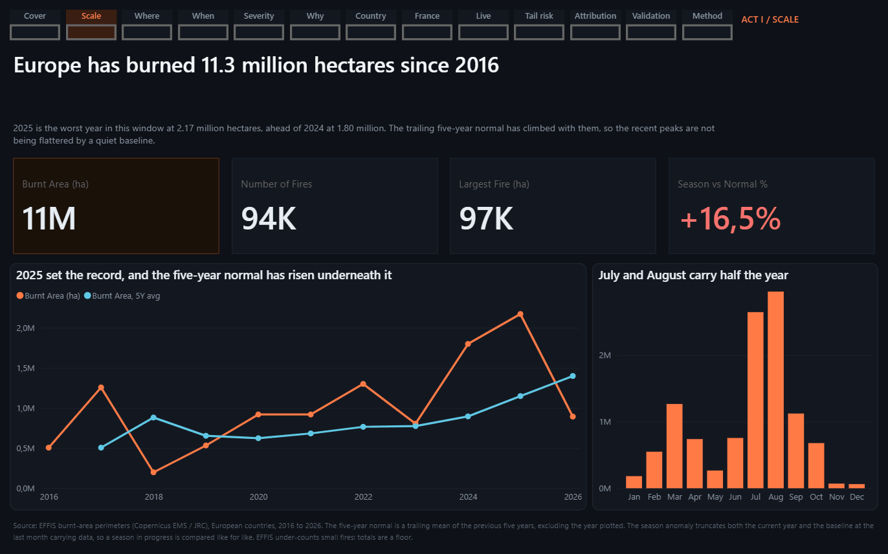
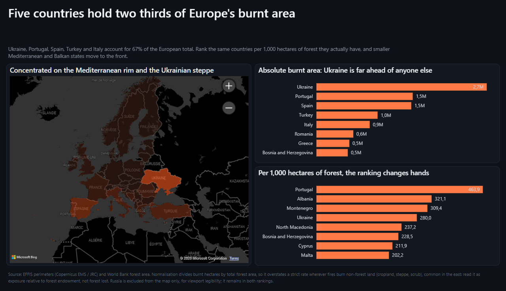
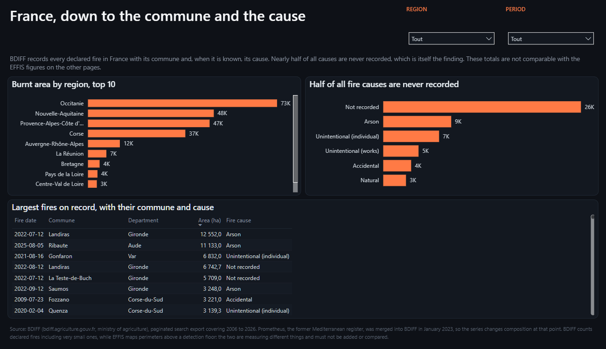
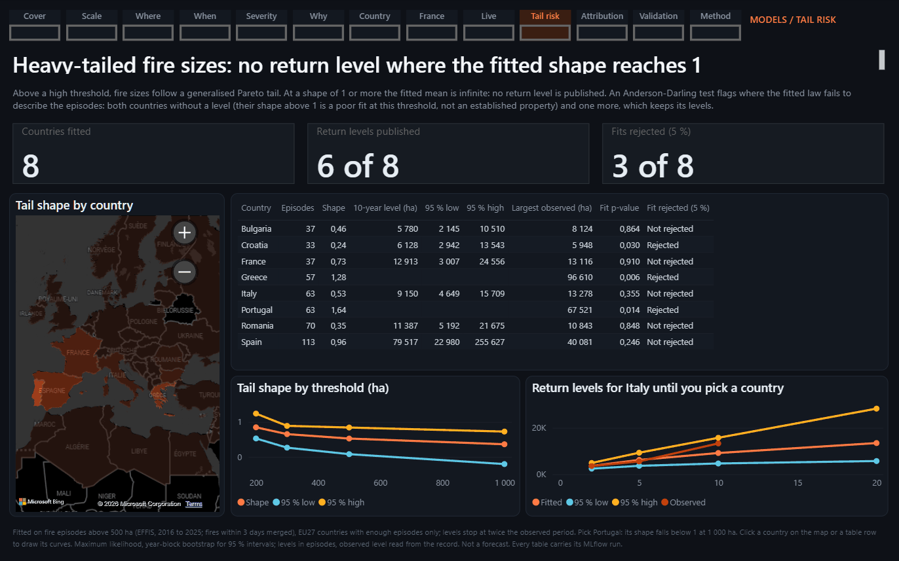
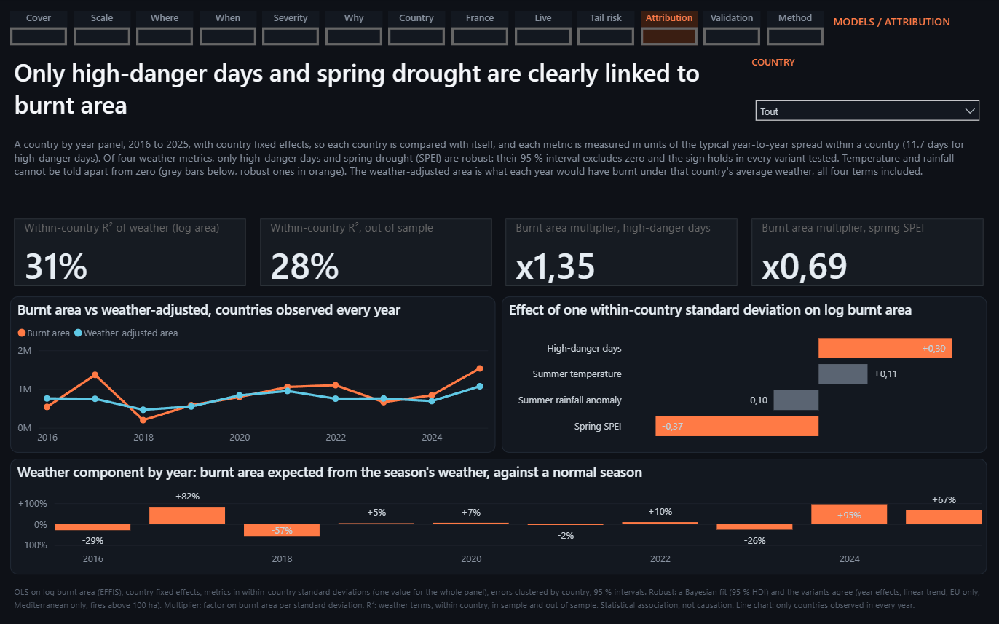
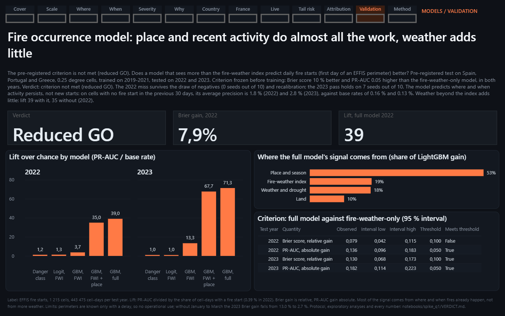
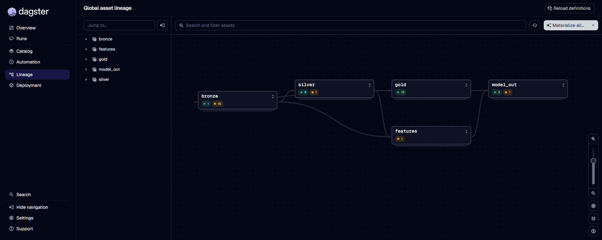

# wildfire-eu-study

Les feux de végétation en Europe, de la donnée publique brute au rapport :
une plateforme de données (Dagster, dbt sur DuckDB, MLflow), un rapport
Power BI de 13 pages, et trois modèles statistiques publiés avec leurs
limites.

Le projet répond à deux sortes de questions, et ne les mélange pas.

- **Ce qui s'est passé** : où l'Europe brûle, quand dans l'année, quels feux
  comptent réellement, ce que faisait la météo au même moment. Dix pages
  descriptives, où chaque chiffre est une agrégation d'une source publique
  citée sur la page.
- **Ce qu'on peut en inférer** : trois modèles, chacun avec une question
  écrite avant le calcul, une validation, et une carte de modèle qui donne
  les limites avant les résultats.



| Où l'Europe brûle | La France, à la commune et à la cause |
|---|---|
|  |  |

## Ce que les modèles disent, et ce qu'ils ne disent pas

| Question | Réponse courte | Ce qu'il ne faut pas en conclure |
|---|---|---|
| **Q1.** Un modèle qui voit plus que l'indice météo prédit-il mieux les départs de feu ? ([carte](docs/models/q1-ignition-spike.md)) | Le critère écrit avant l'entraînement n'est pas atteint : gain de Brier de 7,9 % en 2022 pour un seuil de 10 %. À l'échelle maille x jour, la classe de danger officielle localise à peine mieux que le hasard ; le gain du modèle vient du lieu et de l'activité récente, très peu de la météo. | Ce n'est pas une prévision opérationnelle : le modèle apprend la persistance sur des périmètres connus avec retard. Périmètre limité à l'Espagne, au Portugal et à la Grèce, 2019 à 2023. |
| **Q2.** Quelle taille ont les feux rares ? ([carte](docs/models/q2-tail-risk.md)) | Les tailles de feu ont une queue lourde dans les 8 pays de l'UE étudiés. Un niveau de retour à 10 et 20 ans est publié pour 6 d'entre eux, avec son intervalle. | Pas de chiffre pour le Portugal ni la Grèce : la loi ajustée y est rejetée par le test d'adéquation, un niveau de retour serait une extrapolation sans appui. Dix ans de registre, forme sensible au seuil, intervalles larges. |
| **Q3.** Quelle part de la surface brûlée la météo explique-t-elle ? ([carte](docs/models/q3-attribution.md)) | Environ 30 % de la variabilité d'un pays d'une année à l'autre. Deux effets tiennent dans toutes les variantes : les jours de danger élevé (x 1,35 par écart-type intra-pays) et le déficit hydrique de printemps. | Attribution statistique, pas causale. La température et la pluie ne se distinguent pas de zéro une fois les jours de danger pris en compte. |

Ces résultats ont été durcis par une revue adversariale interne, menée
avant publication : elle a fait retirer un titre que les données ne
soutenaient pas, corriger un effet surestimé d'un facteur deux, et réduire le
périmètre de Q2 de 20 pays à 8. Les cartes de modèle disent ce qui a changé.

| Queue des tailles de feu | Part de la météo | Validation du modèle d'occurrence |
|---|---|---|
|  |  |  |

Les treize pages du rapport sont visibles sans Power BI dans
[docs/report.md](docs/report.md).

## Les règles du projet

- **La couche descriptive ne contient aucun modèle.** Un chiffre factuel ne
  sort jamais d'un modèle, et une sortie de modèle n'est jamais présentée
  comme un fait : les pages de modèles sont séparées et nommées comme telles.
- **Un critère s'écrit avant le calcul.** Le seuil de Q1, les analyses
  exploratoires et la règle qui dit qu'un effet de Q3 est robuste ont été
  commités avant d'être exécutés. Un critère non atteint est publié comme
  non atteint.
- **Une donnée absente reste nulle.** Jamais de zéro de remplissage, jamais
  d'interpolation. `precip_anomaly` est nulle en climat aride parce qu'un
  écart en pourcentage à une normale quasi nulle est un artefact de division.
- **Deux sources qui divergent sont montrées toutes les deux.** BDIFF compte
  les feux déclarés en France, EFFIS cartographie des périmètres au-dessus
  d'un seuil de détection : les deux ne sont jamais additionnés.
- **Une corrélation ne s'affiche jamais sans son horizon commun**, et elle
  est masquée sous dix points d'observation.
- **Chaque table de modèle porte l'identifiant du run MLflow qui l'a
  écrite**, et un test échoue si une carte de modèle cite un autre run.

## Architecture

```
sources publiques (EFFIS, BDIFF, FIRMS, GWIS, Copernicus CDS et EWDS, EDO)
   |   src/ingest/           une source par module, téléchargements reprenables
   v
bronze   data/raw, data/interim      brut tel que reçu
   |   src/transform/        dimensions conformes, faits au grain naturel
   v
silver   data/processed              une table par source, contrat pandera à l'écriture
   |   dbt/ (DuckDB)         13 modèles SQL, tests de grain et de non-mélange des sources
   v
gold     data/lake/gold/star         schéma en étoile lu par Power BI
   |   src/models/           Q1, Q2, Q3, un run MLflow par table
   v
gold     data/lake/gold/model_out    sorties de modèles, lues par 3 pages du rapport
```

Dagster orchestre le tout (`src/orchestration/`, 46 assets, lignage de bout
en bout). Le modèle sémantique Power BI est écrit en TMDL : une constellation
de faits à grains distincts, des dimensions conformes, des relations 1 vers
plusieurs à filtre simple uniquement.

- [docs/platform.md](docs/platform.md) : couches, assets, dbt, modèles.
- [ARCHITECTURE.md](ARCHITECTURE.md) : les frontières entre couches et
  pourquoi elles sont là.
- [docs/adr/](docs/adr/README.md) : dix décisions d'architecture, avec les
  alternatives écartées.
- [docs/models/](docs/models/index.md) : les cartes de modèle.
- [docs/data-model.md](docs/data-model.md) et
  [docs/sources.md](docs/sources.md) : modèle de données et catalogue des
  sources.



## Ce qui est construit, et ce qui ne l'est pas

| Élément | État |
|---|---|
| Ingestion des 8 sources, silver, gold par dbt | matérialisé sur les données réelles |
| Parité avec la v1 | la gold reproduit la v1 valeur pour valeur, vérifié par `tests/test_gold_parity.py` ; deux écarts volontaires, documentés dans `docs/data-model.md` |
| Rapport Power BI | 13 pages, ouvertes et vérifiées dans Power BI Desktop |
| Modèles Q1 (spike), Q2, Q3 | matérialisés, tracés dans MLflow, une carte chacun |
| Feature store maille x jour à l'échelle de l'Europe | code et tests présents, **non matérialisé** : abandonné avec l'extension de Q1 ([ADR 0009](docs/adr/0009-q1-scope-after-reduced-go.md)) |
| Prévision quotidienne | **abandonnée** : elle était conditionnée à un critère Q1 atteint |
| Distribution des données | sorties de modèles dans le dépôt ; schéma en étoile et données brutes **non distribués** (remote DVC déclaré, aucun stockage configuré) : les reconstruire demande les comptes ci-dessous |
| Site de documentation | construit par la CI à chaque changement, pas encore publié |

## Démarrage

Les versions sont verrouillées dans `uv.lock` ; `requirements.txt` en est un
export pour qui préfère pip.

```bash
uv sync          # ou : pip install -r requirements.txt
make check       # ruff, mypy, pytest, construction stricte du site
```

Les tests passent sans réseau et sans données brutes : ceux qui ont besoin
du schéma en étoile se sautent. Les sorties des trois modèles sont commitées
(`data/lake/gold/model_out/`, moins de 300 Ko, et `notebooks/spike_q1/out/`) :
chaque chiffre d'une carte de modèle se retrouve sur un clone neuf avec la
commande de sa section « Reproduire », et la CI vérifie que cartes, tables et
rapport disent la même chose.

Reconstruire les données demande deux comptes gratuits et du temps de
téléchargement. La procédure complète, avec le résultat attendu à chaque
étape, est dans [docs/runbooks/materialise-v2.md](docs/runbooks/materialise-v2.md).
En bref :

```bash
make dbt-build       # gold/star depuis la silver, avec les tests dbt
make dagster-dev     # interface Dagster sur localhost:3000
```

## Ouvrir le rapport : un seul chemin à régler

Power Query n'a pas de notion fiable de « le dossier de ce projet ». Le
chemin des tables est donc un paramètre, déclaré une seule fois dans
`powerbi/WildfireEU.SemanticModel/definition/expressions.tmdl` :

```
expression DataFolder = "C:\...\wildfire-eu-study\data\lake\gold\star"
```

Modifiez cette ligne, ou passez par Accueil > Transformer les données > Gérer
les paramètres dans Desktop. Les tables des pages de modèles se lisent dans le
dossier voisin `gold\model_out`, dérivé du même paramètre. Ce fichier contient
alors un chemin personnel : ne pas le commiter.

## Comptes

Deux comptes gratuits, aucune licence payante :

- **NASA FIRMS** : MAP_KEY gratuite, dans `.env`.
- **ECMWF** : un seul Personal Access Token authentifie le CDS
  (`cds.climate.copernicus.eu`) et l'EWDS (`ewds.climate.copernicus.eu`).
  Seule l'URL de base change, `src/config.py` expose `cds_client("cds"|"ewds")`.
  Les licences des jeux de données s'acceptent une fois en ligne.

EFFIS, GWIS, EDO, BDIFF : ouverts, sans clé.

## Un piège qui a coûté un pays

Natural Earth admin-0 code la France, la Norvège et le Kosovo en
`ISO_A2 = "-99"`. Les trois modules qui attribuent un pays par point-in-polygon
filtraient sur ce champ : **la France était absente de toute la couche climat et
de la table de hotspots**, sur le pays qui a sa propre page. Les totaux
restaient plausibles, rien ne le signalait à l'écran.

Corrigé dans `src/ingest/geo_ref.py`, seul point d'entrée autorisé vers ces
polygones (repli sur `ISO_A2_EH`), et verrouillé par
`test_fireweather_covers_france`.

## Limites connues des données

- EFFIS cartographie au-dessus d'un seuil de détection, qui est passé
  d'environ 20 ha à 1 ha en 2020 : **tous les totaux sont des planchers**, et
  le nombre de petits feux n'est pas comparable avant et après.
- Le FWI et le SPEI sont des moyennes sur tout le territoire d'un pays, pas
  seulement sur la forêt, ce qui tasse l'indice des grands pays.
- Les émissions GFAS voient aussi les feux agricoles et sous le seuil EFFIS :
  elles ne sont **pas divisibles** par la surface brûlée EFFIS.
- La réanalyse FWI est consolidée avec plusieurs mois de retard, donc l'année
  en cours est toujours partielle. Les visuels annuels la neutralisent par la
  mesure `Complete Climate Year`, les modèles ne gardent que les années
  complètes.
- La Russie est exclue de la table d'émissions : 12 % seulement de son
  territoire est dans le domaine d'étude.
- Périodes : périmètres EFFIS depuis 2016, feux déclarés en France (BDIFF)
  depuis 2006, extraction arrêtée fin juillet 2026.

Les limites de chaque modèle sont dans sa carte.

## Attribution

Copernicus Emergency Management Service (EFFIS), Copernicus Climate Change
Service (CDS et EWDS, ERA5, dont la copie publique ARCO-ERA5), Copernicus
European Drought Observatory, Global Wildfire Information System, NASA FIRMS,
Commission européenne (JRC), Open-Meteo (archive historique, CC BY 4.0),
bdiff.agriculture.gouv.fr, geo.api.gouv.fr, Natural Earth, World Bank Open Data.
Réutilisation soumise aux licences respectives, détaillées dans
[docs/sources.md](docs/sources.md).

Les corrélations et les modèles montrés sont descriptifs et n'établissent pas
de causalité.

## Auteur et contact

Tristan Mas. Questions, remarques ou corrections : ouvrez une issue sur ce
dépôt.

Licence du code : MIT, voir [LICENSE](LICENSE). Les jeux de données ingérés ne
sont pas couverts et restent sous leurs licences respectives, voir
[NOTICE](NOTICE).
