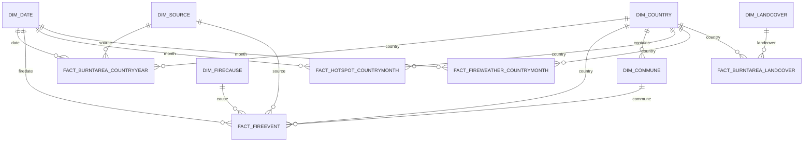

# Modèle de données cible

Statut : proposition, à valider avant de construire les transformations.

## Principe

Constellation (galaxy schema), pas un star schema unique. Les grains des sources
sont incompatibles entre eux : on ne peut pas les fondre dans une seule table de
faits sans mentir sur les chiffres. On a donc plusieurs faits à leur grain
naturel, reliés par des **dimensions conformes** partagées.

Trois garde-fous structurants :

1. **`Dim_Source` est un garde-fou, pas un simple attribut.** Chaque fait porte
   une source. Des mesures de méthodes différentes ne sont jamais sommées. Les
   hotspots (comptage) et les surfaces brûlées (hectares) vivent dans des faits
   séparés : impossible de les additionner par accident.
2. **La France (BDIFF) reste séparée d'EFFIS.** BDIFF est plus fin (commune,
   petits feux, causes) mais non comparable en définition. Il alimente le
   deep-dive France, jamais réconcilié avec les totaux EFFIS en un seul chiffre.
3. **Séparation géospatiale.** Polygones, rasters et points bruts restent côté
   Python (GeoPackage / GeoParquet / NetCDF) pour les cartes et la modélisation.
   Power BI ne consomme que des agrégats tabulaires et des centroïdes. Power BI
   est faible sur le raster et les couches de points à plusieurs millions de lignes.

## Grains

| Table de faits | Grain | Source(s) | Phase |
|---|---|---|---|
| `Fact_FireEvent` | feu individuel | EFFIS périmètres, BDIFF | MVP |
| `Fact_BurntArea_CountryMonth` | pays x mois x source | rollup de `Fact_FireEvent` | MVP |
| `Fact_BurntArea_CountryYear` | pays x année x source | rollup + cross-check EFFIS stats / GWIS | MVP |
| `Fact_BurntArea_LandCover` | pays x année x land cover x source | EFFIS périmètres agrégés | MVP |
| `Fact_FireWeather_CountryMonth` | pays x mois | CDS FWI / ERA5 agrégé | 2 (post-compte CDS) |
| `Fact_Hotspot_CountryMonth` | pays x mois x capteur | FIRMS agrégé | 2 (post-compte FIRMS) |

`Fact_FireEvent` est la source primaire granulaire (périmètres EFFIS, date de
feu, surface, land cover). Les agrégats mois et année en dérivent par rollup ;
les totaux EFFIS stats servent de contrôle de cohérence, pas de source
concurrente. Les colonnes climat (FWI, température, précipitations, humidité,
SPEI) sont remplies depuis la phase 3, voir
`docs/specs/phase3-climate-explanatory.md`.

**Les émissions ne sont pas un attribut de la surface brûlée.** GWIS/GFAS
mesure le feu indépendamment d'EFFIS, donc `co2_emissions_t` vit sur ses
propres lignes de `Fact_BurntArea_CountryYear`, sous `source_key =
"GWIS_GFAS"`, avec `burnt_area_ha` et `number_of_fires` nuls. Poser des tonnes
GFAS sur une ligne EFFIS mélangerait deux sources dans un même enregistrement,
exactement ce que la règle de grain ci-dessus interdit. Conséquence côté
rapport : toute mesure sur `co2_emissions_t` doit neutraliser le filtre
`Dim_Source` (`REMOVEFILTERS`), sinon une page filtrée sur une source de
surface brûlée renvoie du vide.

## Dimensions conformes

**`Dim_Date`** (grain jour, table de dates Power BI, 2000-01-01 -> 2025-12-31)
`date_key, date, year, quarter, month, month_name, week_iso, day_of_year, is_fire_season (juin-sept), season_label`

**`Dim_Country`** (grain pays)
`country_key, iso2, iso3, name_en, name_fr, macro_region (EU / EU_non / ME_AF), is_eu, is_mediterranean, land_area_km2, forest_area_ha`
La `forest_area_ha` sert à normaliser (surface brûlée en % de forêt), sinon on
compare l'Espagne au Luxembourg en valeur absolue, ce qui n'a pas de sens.

**`Dim_Commune`** (grain commune française, deep-dive uniquement)
`commune_key, insee_code, name, department_code, department_name, region_code, region_name, country_key (=FR)`
Snowflake vers `Dim_Country`.

**`Dim_Source`** (grain jeu de données / méthode)
`source_key (EFFIS_STATS, EFFIS_RDA, BDIFF, FIRMS_VIIRS, GWIS_GFAS, CDS_FWI, ERA5, EDO_SPEI), measure_type (burnt_area | emissions | hotspot | fire_weather | climate | drought), spatial_resolution, min_year, method_note`
`FIRMS_MODIS` a été retiré le 2026-07-31 : déclaré depuis le MVP mais jamais
ingéré, il apparaissait dans les segments et ne filtrait rien. Une source ne se
déclare ici que lorsqu'elle est réellement chargée. Le test
`test_dim_source_declares_exactly_the_sources_in_use` verrouille la règle.

**`Dim_LandCover`** (grain classe)
`landcover_key, class_code, class_name (broadleaf, conifer, mixed, sclerophyllous, transitional, other_natural, agricultural, artificial, other), corine_mapping`
Aligné sur le schéma réel des périmètres EFFIS.

**`Dim_FireCause`** (grain cause, BDIFF)
`cause_key, cause_group (natural, accidental, malicious, involuntary, unknown), cause_detail`

## Faits (détail des mesures)

**`Fact_BurntArea_CountryYear`** (l'ossature descriptive)
Clés : `country_key, date_key(année), source_key`
Mesures : `burnt_area_ha, number_of_fires, co2_emissions_t`

**`Fact_BurntArea_LandCover`**
Clés : `country_key, date_key(année), landcover_key, source_key`
Mesures : `burnt_area_ha`

**`Fact_FireEvent`** (grain feu, Europe via EFFIS, France via BDIFF)
Clés : `fire_event_key, source_key, country_key, commune_key (nullable), date_key(firedate), cause_key (nullable)`
Mesures / attributs : `area_ha, ba_class, pct_natura2000, centroid_lat, centroid_lon`
Géométries polygonales stockées à part en GeoPackage, jointes par `fire_event_key`.

**`Fact_Hotspot_CountryMonth`** (FIRMS agrégé pour Power BI)
Clés : `country_key, date_key(mois), source_key`
Mesures : `hotspot_count, mean_frp, max_frp`
Points bruts (lat/lon/timestamp/FRP) conservés en GeoParquet côté Python.

**`Fact_FireWeather_CountryMonth`** (moteur climatique)
Clés : `country_key, date_key(mois)`
Mesures : `mean_fwi, max_fwi, days_fwi_high, days_fwi_very_high, mean_temp, total_precip, precip_anomaly, mean_rh, spei`
Agrégé depuis la grille ERA5/FWI (moyenne spatiale masquée forêt). Rasters bruts
conservés en NetCDF/xarray.

## Mart analytique : abandonné (décision du 2026-07-31)

Le modèle cible prévoyait un `Mart_CountryMonth` dénormalisé comme source
unique de Power BI et d'un futur Streamlit. **Cette table n'est pas construite
et ne le sera pas en l'état.**

Ce qui s'est passé : Power BI consomme directement le schéma en constellation
(`Fact_*` + `Dim_*`), et il le fait bien ; Streamlit n'existe pas et n'est pas
au programme. Construire le mart aujourd'hui reviendrait soit à refondre un
modèle sémantique qui fonctionne pour un bénéfice nul, soit à maintenir une
table que personne ne lit. Les deux sont de la dette.

La jointure que le mart devait matérialiser (surface brûlée x météo-feu x
sécheresse, au grain pays x mois) est déjà exprimable : `Fact_BurntArea_
CountryMonth` et `Fact_FireWeather_CountryMonth` partagent `country_key` et le
grain mois, et sont reliées aux mêmes `Dim_Date` et `Dim_Country`. C'est ce que
fait la mesure `Correlation, danger vs area` de la page Why.

Le jour où une couche analytique Python ou Streamlit arrive, le mart devient
utile et se construit alors comme **sortie parallèle**, sans y basculer Power
BI. Pas avant.

## Chemin des sources

Les partitions ne portent pas de chemin absolu. Le dossier des parquets est un
paramètre M unique, `DataFolder`, déclaré dans
`powerbi/WildfireEU.SemanticModel/definition/expressions.tmdl`. Avant le
2026-07-31 chacune des douze partitions embarquait le chemin complet de la
machine de développement : un clone arrivait avec douze requêtes cassées.

## Schéma

## Décisions arrêtées (2026-07-30)

1. Grain de la couche analytique : `pays x mois` plus rollup annuel.
2. Grain événement-feu (périmètres EFFIS + BDIFF) modélisé dès le MVP. Il devient
   la source primaire dont dérivent les agrégats.

Conséquence : le chemin critique du MVP est l'acquisition des périmètres EFFIS
(WFS GetFeature, l'ancienne API REST est dépréciée) et l'export BDIFF France.
Ce sont les deux vraies tâches d'ingénierie à résoudre en premier.
