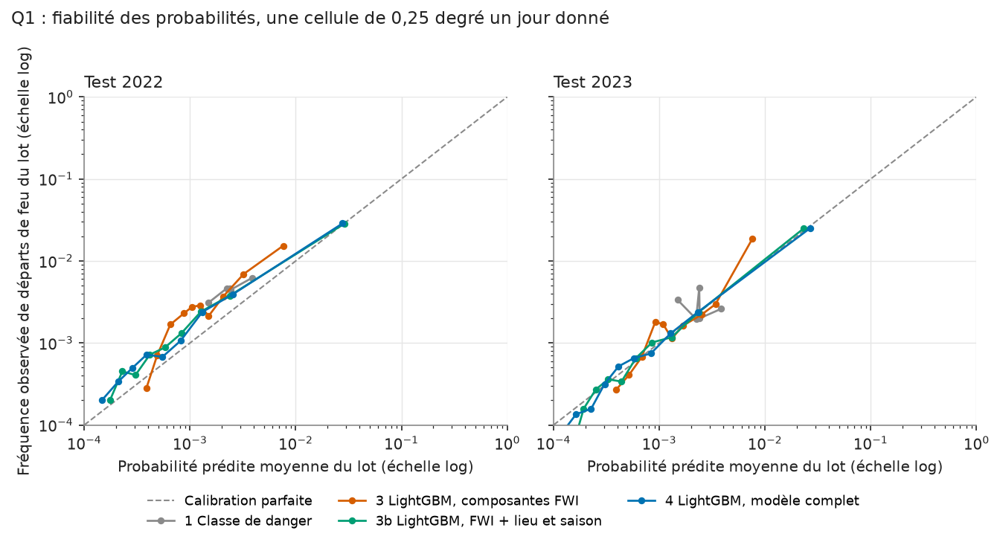
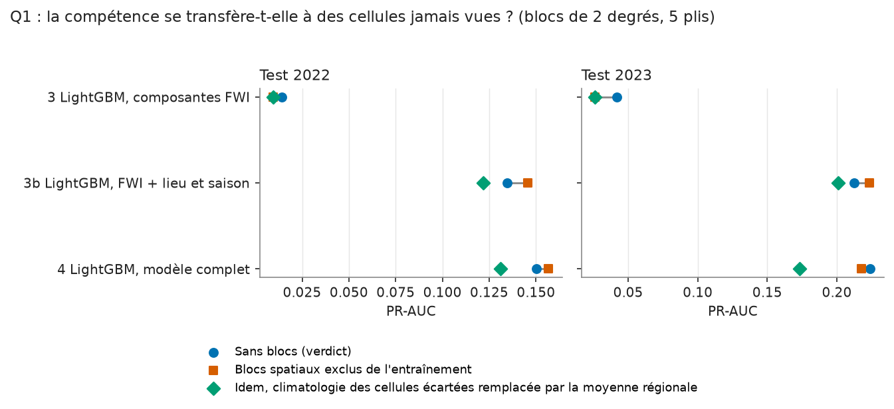
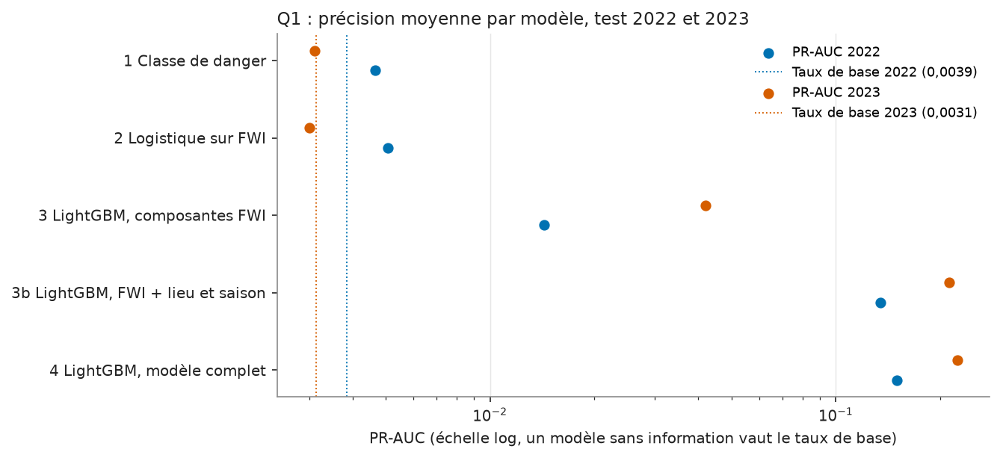

# Carte de modèle : Q1, occurrence des départs de feu (spike)

Run MLflow : `73450271a109409e95ea4851cea5ad77` (expérience `q1_spike`), 2026-11-09. Le
spike lui-même (`notebooks/spike_q1/`) a été exécuté avant la mise en place du suivi
MLflow ; ce run journalise après coup ses sorties gelées (CSV, JSON et PNG de
`notebooks/spike_q1/out/`, dont `criterion_a.json`), les métriques du critère et les
hyperparamètres retenus, sans rien recalculer. Les tables `q1_*` de `model_out` portent
ce `run_id` (asset `gold/q1_spike_results`, qui journalise puis remanie les fichiers).
Le détail du spike est dans `notebooks/spike_q1/VERDICT.md`.

Périmètre : Espagne, Portugal et Grèce, 2019 à 2023, feux cartographiés par EFFIS.
Pas d'extension à l'Europe ([ADR 0009](../adr/0009-q1-scope-after-reduced-go.md)).

!!! abstract "En bref"
    Le critère écrit avant l'entraînement n'est pas atteint : gain de Brier de 7,9 %
    en 2022 pour un seuil de 10 %, et aucun des dix tirages de contrôle ne passe.
    À l'échelle d'une maille et d'un jour, l'indice de danger ne localise presque pas
    les débuts de feu ; le modèle complet le fait 39 à 71 fois mieux que le hasard,
    mais ce gain vient du lieu et de l'activité récente, la météo ajoute très peu.
    **Limite principale : l'étiquette est « un périmètre EFFIS commence ici », connue
    avec retard ; le modèle apprend surtout la persistance, ce n'est pas une
    prévision.** Sur une maille sans feu depuis 30 jours, sa précision moyenne
    tombe à 1,8 % et 2,8 %.

## Question

Un modèle qui voit plus que les composantes de l'indice météo d'incendie (FWI)
prédit-il mieux les jours où un feu démarre que ces composantes seules ? L'unité est
une cellule de 0,25 degré (environ 25 km) un jour donné.

## Données

- 1 215 cellules (Espagne 847, Grèce 220, Portugal 148), 2019 à 2023, soit 2 218 590
  cellules-jours.
- **Étiquette (a), principale** : au moins un périmètre EFFIS dont la date de départ est ce
  jour et dont le centroïde est dans la cellule. 5 648 cellules-jours positives.
- **Étiquette (b), sensibilité** : au moins un nouveau groupe de détections VIIRS dans la
  cellule. 23 349 cellules-jours positives.
- Apprentissage 2019 à 2021, test 2022 et 2023, chaque année notée séparément. Test non
  échantillonné : 443 475 lignes par année, 1 709 positifs en 2022 et 1 393 en 2023
  (taux de base 0,00385 et 0,00314).
- Variables connues le jour J : sept composantes du FWI, météo ERA5 journalière, SPEI-3,
  champs statiques (couverture végétale, relief, fraction de terre), jour de l'année,
  nombre de départs dans la cellule les 7 et 30 jours précédents, climatologie des
  départs de la cellule (calculée sur les années d'apprentissage seulement).
- Substitutions déclarées : les champs statiques ERA5 remplacent CORINE (licence non
  acceptée), la population GHSL est omise, le déficit de pression de vapeur et l'évapotranspiration
  de référence ne sont pas dans le modèle (`et0`, `vpd_max`).

## Méthode

Cinq modèles, du plus simple au plus riche :

| N° | Modèle |
|---|---|
| 1 | Classe de danger officielle du FWI, chaque classe valant le taux de départs observé à l'apprentissage |
| 2 | Régression logistique sur log(1 + FWI) |
| 3 | LightGBM (arbres de décision boostés) sur les sept composantes FWI seules |
| 3b | Modèle 3 plus champs statiques, jour de l'année, nombre de départs récents, climatologie : le « lieu et la saison », sans météo ERA5 ni SPEI |
| 4 | LightGBM sur toutes les variables |

Négatifs échantillonnés 1 sur 20 à l'apprentissage et pondérés par 20, pour que les
probabilités restent calibrées sur le vrai taux de base. Hyperparamètres choisis sur
2021 (apprentissage sur 2019-2020), puis modèle réajusté sur 2019-2021.

**Critère de décision**, écrit avant le premier entraînement et jamais renégocié
(`PROTOCOL.md`), modèle 4 contre modèle 3, étiquette (a) : score de Brier plus bas d'au
moins 10 % en relatif **et** PR-AUC plus haute d'au moins 0,05 en absolu, en 2022 **et** en 2023.
Sinon : GO réduit.

Trois mesures, pour qui ne les pratique pas :

- **PR-AUC** (aire sous la courbe précision-rappel) : pour un événement rare, un
  modèle sans information vaut le taux de base (ici 0,003 à 0,004). Le **lift** est la PR-AUC
  divisée par le taux de base.
- **Score de Brier** : erreur quadratique moyenne des probabilités prédites. Plus bas est mieux.
- **Courbe de fiabilité** : on regroupe les lignes par probabilité prédite et on compare
  la probabilité moyenne prédite à la fréquence réellement observée. Sur la diagonale, le
  modèle est calibré.

Les intervalles du critère viennent d'un bootstrap par blocs d'une semaine (200 réplicats).

## Validation

- **Pré-enregistrement et revue** : protocole commité avant l'entraînement ; une revue
  indépendante avant le premier entraînement a trouvé et corrigé une fuite (climatologie
  construite avec l'année de validation) et ajouté le modèle 3b (`REVIEW.md`).
- **Tests** : `tests/test_spike_results.py` vérifie que les tables `q1_*` portent
  les chiffres du verdict et le `run_id`, que le run MLflow journalise les sorties, et
  que les sorties de E5 à E8 suivent leurs règles.
- **Analyses exploratoires E1 à E8**, écrites avant leur exécution
  (`EXPLORATORY.md`), qui ne modifient pas le verdict. E1 est la validation par blocs
  spatiaux : les cellules sont groupées en blocs de 2 degrés, cinq plis, chaque pli
  est noté sur des blocs absents de l'apprentissage. E5 à E8 ont été déclarées le
  2026-11-09 à la suite de la revue critique, puis exécutées (voir Résultats).
- **Fiabilité** : figure suivante.





Règle de lecture fixée avant E1 : une PR-AUC par blocs à moins de 30 % (en relatif) de
la PR-AUC sans blocs veut dire que la compétence se transfère à des cellules jamais vues.

## Limites

**Ce résultat vaut pour l'Espagne, le Portugal et la Grèce en 2019 à 2023, sur les
feux cartographiés par EFFIS, et pas au-delà : le critère n'est pas atteint, et ce que
le modèle sait surtout, c'est que le feu revient là où il vient de brûler.**

- **Deux années de test.** 1 709 et 1 393 positifs. Le critère échoue sur une seule
  quantité, le gain de Brier de 2022.
- **Sensibilité à l'échantillon d'apprentissage.** Le bootstrap rééchantillonne les
  semaines de test, pas l'échantillon des négatifs. E4 refait l'apprentissage avec
  dix graines : le verdict reste celui de la graine 42, E4 donne la dispersion.
- **Persistance.** Les deux nombres de départs récents dans la cellule et la
  climatologie sont les trois variables les plus importantes. Sur les cellules sans
  départ depuis 30 jours (E3), la compétence recule fortement (voir Résultats).
- **E1 ne supprime pas la mémoire du lieu.** Les cellules écartées de l'apprentissage
  gardent leurs propres variables (départs récents, climatologie calculée sur leur
  historique 2019-2021). E1 montre que le modèle ajusté ne dépend pas des cellules
  vues à l'apprentissage, pas que l'historique local est dispensable. Les blocs sont
  contigus aux blocs d'apprentissage : l'autocorrélation spatiale aux frontières n'est
  pas supprimée.
- **Calibration et décalage de taux de base.** Les modèles 1 à 3 sous-estiment le nombre
  de départs d'un facteur 1,5 à 2,0 sur les deux années (rapport observé sur prédit, voir
  Résultats). Le taux de base de l'apprentissage est d'environ 0,0019 (2 546 positifs sur
  1 331 640 cellules-jours), la moitié de celui du test 2022 (0,0039) : le score de
  Brier du critère mesure donc aussi ce décalage de calibration, pas seulement la
  capacité à classer les jours.
- **Étiquette.** (a) manque les départs plus petits que la taille cartographiée par
  EFFIS ; (b) VIIRS est plus fréquente mais le résultat y est plus faible (gain de Brier
  de 5,6 % et 3,6 %). L'étiquette (a) est « un périmètre EFFIS commence dans la cellule
  ce jour » : elle mêle départs nouveaux et persistance (18 % des positifs ont un
  positif la veille dans la même cellule) et 35 % des positifs tombent de janvier à
  mars. Le plancher de taille des périmètres change en 2020 (environ 20 ha jusque 2019,
  1 ha ou moins ensuite), donc la définition de l'étiquette bouge dans les années
  d'apprentissage. Cette carte dit « persistance et lieu » là où E3 le montre.
- **Latence d'EFFIS.** Les périmètres sont cartographiés après coup et publiés avec
  un délai, et leur date de départ est une estimation. Les nombres de départs récents
  utilisent des événements qu'un prévisionniste n'aurait pas encore le matin du jour J.
  Le spike dit ce que l'historique consolidé d'une cellule prédit, pas ce qu'on saurait
  en temps réel. Aucun usage opérationnel n'est prévu (Q4 abandonné) et les délais n'ont
  pas été recalculés sur VIIRS.
- **Ce que le critère compare.** Le critère oppose le modèle 4 au modèle 3 : entre les
  deux, il y a à la fois le lieu, la saison, l'activité récente et la météo. Il ne teste
  donc pas « la météo ajoute-t-elle quelque chose à l'indice ». Le modèle 3b, ajouté
  par la revue du protocole avant tout entraînement, isole cette question : du 3b au 4, la météo ERA5 et le
  SPEI apportent 1,6 % et 0,6 % de Brier, et +0,016 et +0,012 de PR-AUC.
- **Un seuil de Brier sans référence.** Les modèles 1 à 3 ont le score de Brier d'une
  prévision constante au taux de base : leur compétence (1 moins le rapport au Brier
  de cette prévision constante) est nulle, de -0,1 % à 1,2 % selon le modèle et l'année.
  Celle du modèle complet est de 8,2 % en 2022 et 14,0 % en 2023. Le critère exprimé en
  gain relatif sur le modèle 3 revient donc presque à un seuil de compétence absolue.
- **Le critère de 2023 s'appuie sur l'hiver.** Sans janvier à mars (54,5 % des positifs
  de 2023), le gain de Brier de 2023 tombe de 13,0 % à 2,7 % (E7).
- **Substitutions** de CORINE, de GHSL, absence de `et0` et `vpd_max`.
- **Pas de modèle d'ignition pour toute l'Europe** : abandon décidé en ADR 0009.

## Résultats

### Verdict : GO réduit

Étiquette (a), modèle 4 contre modèle 3. Intervalle à 95 % du bootstrap par blocs.

| Année | Gain de Brier (relatif) | Seuil | Gain de PR-AUC (absolu) | Seuil | Résultat |
|---|---|---|---|---|---|
| 2022 | 7,9 % [4,2 % ; 11,5 %] | 10 % : non atteint | +0,136 [0,096 ; 0,183] | 0,05 : atteint | ÉCHEC |
| 2023 | 13,0 % [6,8 % ; 17,3 %] | 10 % : atteint | +0,182 [0,114 ; 0,223] | 0,05 : atteint | SUCCÈS |

Le critère n'est pas atteint : **GO réduit**. L'échec vient d'une seule quantité, le
gain de Brier de 2022, 2,1 points sous le seuil. Son intervalle bootstrap [4,2 % ; 11,5 %]
contient 10 %, mais il ne rééchantillonne que les semaines de test. E4 ajoute l'autre
source de variance, l'échantillon d'apprentissage : sur dix graines, le gain de 2022
a pour médiane 5,7 % et pour plage 3,4 % à 7,9 %, aucune graine ne passe en 2022
(0 sur 10), sept sur dix passent en 2023, aucune ne passe les deux années. La valeur
de la graine 42 (7,9 %, hors des dix graines) est tout en haut de cette plage. L'échec
de 2022 n'est donc pas un accident d'arrondi près du seuil : il résiste au tirage des
négatifs, alors que la réussite de 2023 tient sur la plupart des tirages mais pas sur
tous. La PR-AUC du modèle 4 en 2022 de la graine du verdict est sous le minimum des
dix graines (0,1503 contre 0,1543).

### Scores par modèle, étiquette (a)

| Modèle | PR-AUC 2022 | Lift 2022 | PR-AUC 2023 | Lift 2023 |
|---|---|---|---|---|
| 1 Classe de danger | 0,0047 | 1,2 | 0,0031 | 1,0 |
| 2 Logistique FWI | 0,0051 | 1,3 | 0,0030 | 1,0 |
| 3 LightGBM FWI | 0,0143 | 3,7 | 0,0419 | 13,3 |
| 3b LightGBM FWI + lieu et saison | 0,1347 | 35,0 | 0,2126 | 67,7 |
| 4 LightGBM complet | 0,1503 | 39,0 | 0,2241 | 71,3 |



Calibration : sur l'ensemble de l'année, le rapport entre départs observés et départs
prédits vaut 1,96, 1,89, 2,02 (modèles 1, 2, 3) en 2022 et 1,59, 1,52, 1,57 en 2023 ;
il vaut 1,10 (3b) et 1,13 (4) en 2022, 1,05 et 0,95 en 2023.

### Ce que disent E1 à E4

Les nombres de départs récents sont une mesure de persistance de l'activité du lieu :
on parle de persistance et de lieu, pas de départs nouveaux.

Récit de l'[ADR 0009](../adr/0009-q1-scope-after-reduced-go.md), repris phrase par
phrase et limité à ce que les analyses exploratoires confirment.

**1. « À l'échelle maille x jour, l'indice de danger ne localise presque pas les
départs. » Confirmé.** Lift de la classe de danger : 1,2 (2022) et 1,0 (2023), de la
logistique 1,3 et 1,0. Le modèle 3, plus souple, monte à 3,7 et 13,3 mais E1 montre qu'il ne transfère pas :
sur des blocs de cellules jamais vues sa PR-AUC tombe de 32 % (0,0097 contre 0,0143)
puis de 37 % (0,0263 contre 0,0419). Les modèles 3b et 4 restent à moins de 30 % de leur PR-AUC sans
blocs (modèle 4 : -4,3 % en 2022, +2,9 % en 2023 ; 3b : -8,1 % et -5,0 %,
un signe négatif voulant dire que la PR-AUC par blocs est plus haute).

**2. « La mémoire du lieu et de l'activité récente localise les départs. » Confirmé,
avec la persistance pour mécanisme principal.** Importance des variables du modèle complet
(part du gain) : départs dans la cellule les 7 jours précédents 17,0 %, les 30 jours précédents
16,5 %, climatologie de la cellule 15,3 % ; en groupes, lieu et saison 52,5 %, indice
de danger 18,7 %, météo et sécheresse 18,4 %, terrain 10,4 %. L'ablation E2, en
part de la PR-AUC du modèle 3b (2022, puis 2023) : sans les départs récents 72,1 % et
75,6 % ; avec le FWI et les départs récents seulement 90,5 % et 93,2 % ; sans aucune
variable FWI 70,7 % et 68,5 %. Aucun bloc ne porte seul le gain, les départs récents
avec le FWI s'en approchent le plus, et plus des deux tiers demeurent sans aucune
entrée FWI.
E3 précise le mécanisme : sur les cellules sans départ depuis 30 jours (38,2 % à 39,5 %
des positifs du test), le lift du modèle 4 est 11,3 et 22,4, contre 39,0 et 71,3 sur
tous les jours, et son avantage en PR-AUC sur le modèle 3 tombe à +0,014 et +0,021
(contre +0,136 et +0,182). Sur la sélection stricte, sans départ dans le voisinage 3 x 3
depuis 30 jours (16 % à 18 % des positifs), le lift du modèle 4 est 5,9 et 26,7.
Une grande part du gain est donc la persistance d'un même foyer, et le modèle reste
nettement au-dessus du modèle 3 en lift sur les départs nouveaux
(2,6 à 7,4 fois). Sur un départ nouveau, le lift du modèle 4 est environ 30 %
de son lift moyen (11,3 sur 39,0 en 2022, 22,4 sur 71,3 en 2023). En valeur absolue,
la précision moyenne (PR-AUC) du modèle complet sur ces mailles sans départ depuis 30
jours est de 0,018 en 2022 et 0,028 en 2023, pour des taux de base de 0,0016 et 0,0013 :
un lift de 11 sur un événement aussi rare reste une précision de moins de 3 %.

**3. « La météo ajoute peu. » Confirmé en moyenne, nuancé sur les départs nouveaux.**
Du modèle 3b au modèle 4, le gain de PR-AUC est de +0,016 (2022) et +0,012 (2023) et le
gain relatif de Brier de 1,6 % et 0,6 %. Sur les départs nouveaux, le lift passe de 9,8
à 11,3 (cellule, 2022), de 4,6 à 5,9 (voisinage, 2022), de 19,5 à 26,7 (voisinage, 2023),
mais reste à 22,6 contre 22,4 (cellule, 2023). La météo pèse un peu plus quand il n'y a
pas de départ récent, en valeur absolue ces gains sont petits : de -0,0003 à +0,005 de PR-AUC du modèle 3b
au modèle 4 sur ces sous-ensembles.

### Ce que disent E5 à E8

Analyses déclarées le 2026-11-09 avant leur exécution, qui ne modifient pas le verdict.

| Analyse | Question | Résultat |
|---|---|---|
| E5 recalibration d'intercept appris sur 2021 | L'échec de 2022 vient-il du décalage de taux de base ? | Non : gain de Brier du modèle 4 sur le modèle 3 de 8,2 % (2022, 7,9 % avant) et 12,9 % (2023, 13,0 % avant). Les deux modèles sont décalés pareillement. Limite : l'intercept est appris sur 2021, année d'apprentissage dont le taux (0,0026) reste sous celui de 2022 (0,0039). |
| E6 étiquette restreinte aux périmètres de 30 ha ou plus | Le changement de plancher de 2020 explique-t-il le résultat ? | Non : lift du modèle 4 de 44,3 et 154,4, gain de PR-AUC +0,060 et +0,121, gain de Brier de 2,3 % et 5,5 % (sous 10 % dans les deux années). |
| E7 sans janvier à mars | Le résultat tient-il hors de la saison où l'étiquette est la plus mêlée ? | En partie seulement : lift du modèle 4 de 28,7 et 48,9 (contre 39,0 et 71,3), gain de PR-AUC +0,087 et +0,087 (contre +0,136 et +0,182), gain de Brier de 4,2 % et 2,7 %. La réussite de 2023 sur le Brier ne survit pas au retrait de l'hiver (54,5 % des positifs 2023). |
| E8 blocs spatiaux, climatologie sans les blocs écartés | E1 était-il trop favorable ? | Un peu : PR-AUC par blocs du modèle 4 de 0,1311 et 0,1734, baisse de 12,8 % et 22,6 % (E1 : -4,3 % et +2,9 %) ; modèle 3b : 9,5 % et 5,5 %. Les deux restent sous 30 %, la lecture de E1 tient avec une marge plus faible. |

Le récit de la publication, limité à l'Ibérie et à la Grèce, 2019 à 2023, feux cartographiés
par EFFIS : l'indice de danger ne localise pas les départs à l'échelle maille x jour ;
la mémoire du lieu et de l'activité récente le fait, surtout par persistance d'un même
foyer ; la météo ajoute peu ; le gain de 2023 dépend en partie des départs de janvier
à mars. Aucune phrase de cette carte ne va plus loin.

## Reproduire

Depuis la racine du dépôt. Les fichiers `notebooks/spike_q1/out/` sont commités ;
les tables `q1_*` de `data/lake/gold/model_out/` le sont aussi (asset
`gold/q1_spike_results`).

Critère, intervalles, scores et lift (tables `q1_criterion`, `q1_metrics`) :

```bash
uv run python -c "import pandas as pd; M='data/lake/gold/model_out/'; print(pd.read_parquet(M+'q1_criterion.parquet').round(4).to_string()); print(pd.read_parquet(M+'q1_metrics.parquet')[['year','model','base_rate','pr_auc','lift','brier']].round(5).to_string())"
```

Taux de base de l'apprentissage (positifs 2019 à 2021 de la concordance, sur les 1 331 640
cellules-jours d'apprentissage du verdict) :

```bash
uv run python -c "import pandas as pd; c=pd.read_csv('notebooks/spike_q1/out/concordance.csv'); n=c[c.year.astype(str).isin(['2019','2020','2021'])].a_positives.sum(); print(n, round(n/1331640,5))"
```

Compétence de Brier de chaque modèle contre une prévision constante au taux de base, et
précision moyenne sur les mailles sans départ depuis 30 jours :

```bash
uv run python -c "import pandas as pd; m=pd.read_parquet('data/lake/gold/model_out/q1_metrics.parquet'); m['skill']=1-m.brier/(m.base_rate*(1-m.base_rate)); print(m[['year','model','skill']].round(4).to_string()); n=pd.read_csv('notebooks/spike_q1/out/exploratory_new_ignitions.csv'); print(n[(n.subset=='cell_new_30d')&(n.model=='lgbm_full')][['year','base_rate','pr_auc','lift']].round(4).to_string())"
```

Gain de Brier du modèle 3b au modèle 4 et rapport observé sur prédit (calibration) :

```bash
uv run python -c "import pandas as pd; M='data/lake/gold/model_out/'; m=pd.read_parquet(M+'q1_metrics.parquet'); p=m.pivot(index='year',columns='model',values='brier'); print((1-p['lgbm_full']/p['lgbm_fwi_space']).round(4)); r=pd.read_parquet(M+'q1_reliability.parquet'); print(r.groupby(['year','model']).apply(lambda g: (g.obs_rate*g.n).sum()/(g.mean_pred*g.n).sum(), include_groups=False).round(2))"
```

Importance des variables :

```bash
uv run python -c "import pandas as pd; i=pd.read_parquet('data/lake/gold/model_out/q1_importance.parquet'); print(i.head(6)[['rank','feature','share']].round(3)); print(i.groupby('feature_group').share.sum().round(3))"
```

Recalibration (E5), étiquette 30 ha (E6), sans janvier à mars (E7), blocs avec climatologie
régionale (E8) :

```bash
uv run python -c "import pandas as pd; O='notebooks/spike_q1/out/'; r=pd.read_csv(O+'exploratory_recalibration.csv'); print(r[['year','model','shift_logit','obs_over_pred_raw','obs_over_pred_recal','brier_rel_gain_raw','brier_rel_gain_recal']].round(4).to_string()); print(pd.read_csv(O+'exploratory_label30ha.csv').query('model==\"lgbm_full\"')[['year','positives','pr_auc','lift','brier_rel_improvement','pr_auc_gain']].round(4).to_string()); print(pd.read_csv(O+'exploratory_no_winter.csv').query('model==\"lgbm_full\"')[['year','lift','brier_rel_improvement','pr_auc_gain','share_test_positives_removed']].round(4).to_string()); print(pd.read_csv(O+'exploratory_spatial_blocks_clim.csv')[['year','model','pr_auc','pr_auc_unblocked','relative_drop','transfers']].round(4).to_string())"
```

Blocs spatiaux (E1), ablation (E2), départs nouveaux (E3), graines (E4) :

```bash
uv run python -c "import pandas as pd; O='notebooks/spike_q1/out/'; print(pd.read_csv(O+'exploratory_spatial_blocks.csv')[['year','model','pr_auc','pr_auc_unblocked','relative_drop','transfers']].round(4).to_string()); print(pd.read_csv(O+'exploratory_ablation.csv')[['year','model','pr_auc','share_of_3b_pr_auc']].round(3).to_string()); n=pd.read_csv(O+'exploratory_new_ignitions.csv'); print(n[n.subset!='all'][['year','subset','model','pr_auc','lift','share_of_positives']].round(4).to_string()); print(pd.read_csv(O+'exploratory_seeds_summary.csv').round(4).to_string())"
```

Résultats de la graine du verdict contre le minimum des graines (PR-AUC du modèle 4 en 2022) :

```bash
uv run python -c "import pandas as pd; O='notebooks/spike_q1/out/'; m=pd.read_csv(O+'metrics_a.csv'); print(m[(m.year==2022)&(m.model=='lgbm_full')].pr_auc.round(4).tolist()); print(pd.read_csv(O+'exploratory_seeds_summary.csv')[['year','pr_auc_m4_min','brier_rel_max']].round(4))"
```

Rejouer le spike (nécessite les données téléchargées, voir
[la procédure du spike](../runbooks/spike-q1.md)) puis régénérer les tables et figures :

```bash
uv run python notebooks/spike_q1/s05_build_dataset.py
uv run python notebooks/spike_q1/s06_train_evaluate.py a b
uv run python notebooks/spike_q1/s07_concordance.py
uv run python notebooks/spike_q1/s08_exploratory.py
uv run python notebooks/spike_q1/s09_exploratory.py
uv run dagster asset materialize -m src.orchestration.definitions --select "gold/q1_spike_results"
uv run python scripts/model_figures.py
```
