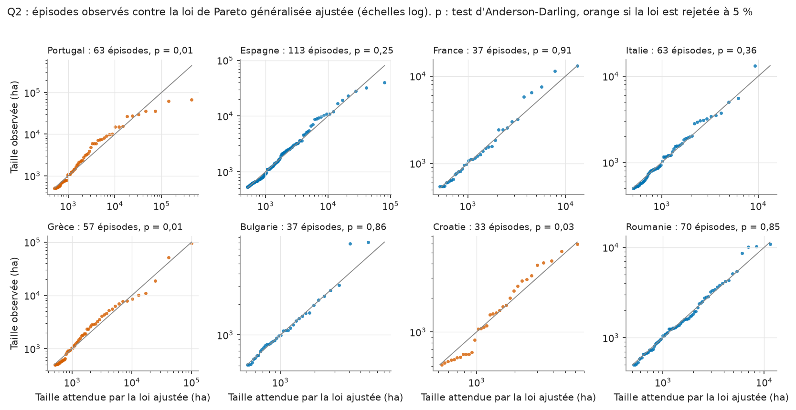
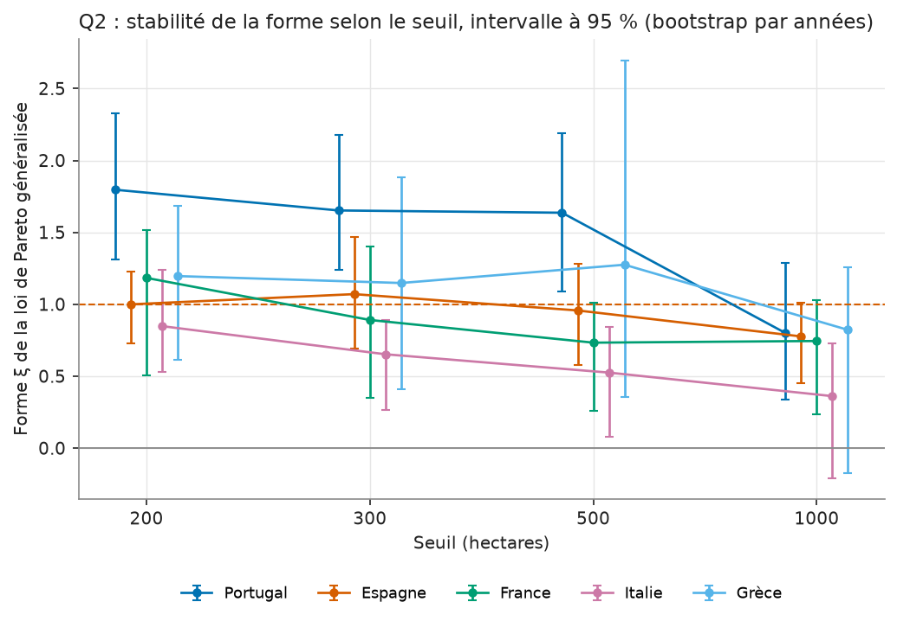

# Carte de modèle : Q2, queue des tailles de feux

Run MLflow : `b47581300d4b4f2a828fffa5b76530e3` (expérience `q2_tail_risk`, run
`country_20261110`, tag `published=true`), 2026-11-10. Les tables
`tail_risk_country`, `tail_risk_levels`, `tail_risk_threshold_stability`,
`tail_risk_gof` et `tail_risk_episodes` portent ce `run_id` sur chaque ligne.

!!! abstract "En bref"
    Dans les 8 pays de l'UE étudiés, la taille des grands épisodes de feu a une
    queue lourde. Un niveau de retour à 10 et 20 ans est publié pour 6 pays, avec
    un intervalle large (Espagne à 10 ans : 23 000 à 256 000 ha). Pas de chiffre
    pour le Portugal ni la Grèce : la loi ajustée y est rejetée par le test
    d'adéquation et sa forme dépasse 1. **Limite principale : dix ans de registre
    et un seuil de 500 ha où le régime de queue n'est pas atteint partout.** À
    lire comme un classement des pays par queue, pas comme une prévision.

## Question

Quelle est la taille d'un feu rare, celui qu'un pays voit en moyenne une fois
tous les 5, 10 ou 20 ans, et avec quelle incertitude ? La réponse sert à
comparer les pays sur leurs plus gros feux, pas sur leur surface brûlée totale,
qui est dominée par la saison la plus sèche de la période.

## Données

- Table `fact_fireevent`, lignes EFFIS : un feu cartographié, sa surface en
  hectares, sa date de départ, son pays. 50 pays ou territoires dans le registre.
- Seuil absolu de 500 ha, le même partout (voir Méthode). Les feux plus petits ne
  sont pas modélisés.
- Seules les années complètes comptent : l'extraction 2026 s'arrête en juillet,
  avant la plus grande part de la saison du Sud, et la compter comme une année
  entière ferait baisser le taux. La période de chaque pays va de son premier
  enregistrement, de toute taille, à 2025 : 2016 à 2025 pour les 28 pays les plus
  anciens du registre.
- **Périmètre publié : 8 pays sur 50.** Pays de l'UE27 avec au moins 8 années
  complètes et au moins 30 épisodes au-dessus du seuil : Bulgarie, Croatie,
  Espagne, France, Grèce, Italie, Portugal, Roumanie. Les 42 autres sont exclus :
  24 hors UE27 (Algérie, Ukraine, Turquie, Syrie et d'autres, dont la complétude du
  registre n'est pas évaluée), 15 de l'UE27 avec moins de 30 épisodes (dont
  l'Allemagne : 7), 3 de l'UE27 avec moins de 8 années (Autriche, Lituanie,
  Slovaquie). Le motif est dans la colonne `scope_reason` de la table complète,
  loguée comme artefact `perimeter` du run.

## Méthode

Une loi de probabilité ajustée sur tous les feux décrirait surtout les petits.
On ne modélise donc que la queue, par la méthode des dépassements de seuil
(peaks over threshold), pays par pays :

1. **Seuil absolu de 500 ha.** Un quantile des tailles du pays dépendrait du plancher de
   cartographie EFFIS, qui est passé de 15 à 24 ha avant 2020 à 0 à 1 ha après : le
   quantile 90 d'un mélange qui change de composition. Le nombre annuel de feux de
   plus de 500 ha ne dépend pas de ce plancher.
2. **Déclustering par épisode.** Dans un même pays, les feux au-dessus du seuil dont
   les dates sont séparées de 3 jours ou moins sont fusionnés en un épisode, chaîné
   (chaque feu est comparé au précédent dépassement). On garde le plus gros feu de
   l'épisode. Les dépassements groupés sont un même épisode météo et ne sont pas
   indépendants, ce que la loi suppose. Le Portugal passe ainsi de 313 feux de plus
   de 500 ha à 63 épisodes.
3. **Loi de Pareto généralisée (GPD)** sur l'excès de chaque épisode au-dessus du
   seuil, ajustée par maximum de vraisemblance. Deux paramètres : une échelle
   et une **forme** ξ. La forme dit à quelle vitesse la queue s'amincit. ξ = 0 :
   décroissance exponentielle. ξ > 0 : queue lourde, les très gros feux restent
   plausibles. ξ ≥ 1 : l'espérance de l'excès n'existe plus, c'est-à-dire que la
   moyenne des plus gros feux n'est pas bornée par le modèle. Le taux est le
   nombre d'épisodes par année observée.
4. **Niveau de retour** x_T : la taille de l'épisode dépassée en moyenne une fois
   toutes les T années, `x_T = u + (sigma / xi) * ((T * taux)^xi - 1)`.
5. **Intervalle par bootstrap par blocs d'années.** 500 réplicats : on tire
   autant d'années que d'années observées, avec remise, chaque année apportant tous
   ses épisodes (une année sans épisode n'en apporte aucun), puis on réajuste.
   L'incertitude sur le nombre d'épisodes par an est donc dans la bande, de même que
   la dépendance à l'intérieur d'une année. Percentiles 2,5 % et 97,5 %.
6. **Règle de publication d'un niveau.** Un niveau n'est publié que si ξ ponctuel
   est strictement inférieur à 1 et si la période de retour ne dépasse pas deux
   fois la durée observée (20 ans avec 10 ans de registre : le niveau à 50 ans est
   nul par construction). Un niveau absent est nul et deux colonnes disent pourquoi :
   `shape_below_one` (pays) et `within_horizon` (niveau), `published` valant leur
   conjonction dans `tail_risk_levels`.
7. **Stabilité du seuil.** Table `tail_risk_threshold_stability` : pour chaque pays du
   périmètre, ξ et son intervalle (200 réplicats) aux seuils 200, 300, 500 et
   1 000 ha, avec re-déclustering à chaque seuil.
8. **Adéquation de la loi.** Table `tail_risk_gof` : distance d'Anderson-Darling entre
   les excès des épisodes et la loi ajustée (elle pèse les extrémités, là où un modèle
   de queue doit tenir), avec une p-valeur par bootstrap paramétrique : 500 échantillons
   tirés de la loi ajustée, chacun réajusté avant de calculer sa distance, ce qui tient
   compte du fait que les deux paramètres sont estimés. Règle de lecture écrite dans
   `src/models/extremes.py` et commitée avant l'exécution sur les données réelles :
   sous 5 %, la loi est rejetée pour ce pays à ce seuil, et la carte le dit à côté de ses
   estimations ; la règle de publication ne change pas. La table `tail_risk_episodes`
   donne chaque épisode avec la taille que la loi attend à son rang.

Le niveau empirique est affiché en regard : c'est la taille du k-ième plus gros
épisode observé, avec k = années / T. À 10 ans, c'est donc le plus gros feu de la
période.

## Validation

- Tests (`tests/test_models_extremes.py`) : des feux espacés de 1 ou 2 jours forment un
  seul épisode et 4 jours en font deux ; la GPD ajustée sur des épisodes simulés
  retrouve ξ = 0,4, l'échelle et le taux connus (400 années simulées) ; le bootstrap
  par blocs donne une bande plus large qu'un rééchantillonnage des épisodes à taux fixe quand le taux
  varie beaucoup d'une année à l'autre ; le périmètre et ses trois motifs d'exclusion ; la
  règle de publication (ξ ≥ 1 et horizon) ; le schéma des trois tables ; une année finale
  partielle est exclue ; le tag `published` ne reste que sur le dernier run.
- Contrôle visuel sur les données réelles : la figure ci-dessous place le niveau
  empirique sur la courbe ajustée, là où elle est publiée.


**Adéquation, sur les données réelles.** La loi n'est pas rejetée pour cinq pays et
elle l'est pour trois :

| Pays | Épisodes | p-valeur | Loi rejetée à 5 % |
|---|---|---|---|
| France | 37 | 0,91 | non |
| Bulgarie | 37 | 0,86 | non |
| Roumanie | 70 | 0,85 | non |
| Italie | 63 | 0,36 | non |
| Espagne | 113 | 0,25 | non |
| Croatie | 33 | 0,030 | **oui** |
| Portugal | 63 | 0,014 | **oui** |
| Grèce | 57 | 0,006 | **oui** |



Lecture de la figure : un point sur la diagonale est un épisode de la taille que la loi
attend à son rang. Au Portugal, les plus gros épisodes sont très en dessous de la
diagonale : la loi ajustée attend 442 516 ha pour le plus gros, il fait 67 521 ha. La
forme de 1,64 vient du corps de la distribution, pas de ses extrêmes. Une p-valeur haute
n'est pas une preuve : avec 37 épisodes (France, Bulgarie), le test a peu de puissance.

## Limites

**Le Portugal et la Grèce n'ont pas de niveau de retour publié : leur forme
ponctuelle est au-dessus de 1 (1,64 et 1,28), et la loi ajustée y est rejetée par
le test d'adéquation.** Une forme au-dessus de 1 ne dit donc pas que leurs feux
ont « une moyenne infinie » : elle dit que la loi de Pareto généralisée ne décrit
pas leurs épisodes au-dessus de 500 ha, et qu'un niveau de retour tiré de cette
loi serait une extrapolation sans appui. Ce que les données disent de ces deux
pays se lit dans les niveaux observés, pas dans le modèle.

- **La Croatie est publiée alors que sa loi est rejetée** (p = 0,030, 33 épisodes).
  Ses niveaux (6 128 ha à 10 ans, intervalle 2 942 à 13 543) restent dans la table
  parce que la règle de publication a été fixée avant le test ; ils sont à lire avec
  cette réserve, et la table `tail_risk_gof` porte le drapeau `gpd_rejected`.
- **Huit tests, sans correction de multiplicité.** Au seuil de 5 %, un rejet sur huit
  par hasard n'aurait rien d'étonnant ; trois, dont deux sous 1,5 %, ne s'expliquent
  pas ainsi.

Pour mémoire, l'ancienne version (seuil au quantile 90, tous les feux, bootstrap
des feux) publiait pour le Portugal un niveau à 10 ans de 286 596 ha, 4,2 fois
le plus gros feu observé.

- **ξ n'est pas stable selon le seuil.** Au Portugal, ξ vaut 1,80, 1,65, 1,64 puis 0,80
  aux seuils 200, 300, 500 et 1 000 ha. Il est plus bas à 1 000 ha qu'à 200 ha dans les
  cinq pays détaillés (Italie : 0,85 à 0,36), sans être monotone partout. Le régime asymptotique n'est donc pas atteint à
  500 ha pour les pays ibériques et la Grèce, ou 10 ans ne permettent pas de le
  voir. À 1 000 ha, les intervalles de quatre des cinq pays contiennent ou touchent 1.
- **Seulement 10 ans.** Un niveau à 10 ans est lui-même proche de la durée du
  registre, et un maximum observé inférieur au niveau ajusté n'a rien d'anormal : un
  niveau décennal n'est pas atteint en dix ans environ une fois sur trois (e^-1, soit 37 %).
- **Intervalles larges, par blocs de 10 années.** Avec 10 blocs, le bootstrap
  par années est grossier. Il propage l'incertitude du taux, mais ne l'estime pas
  finement. L'Espagne est publiée avec ξ = 0,96, à la limite de la règle ; son niveau
  à 20 ans va de 35 772 à 611 014 ha.
- **Seuil de 500 ha et déclustering de 3 jours** sont des choix, pas des estimations.
  La fenêtre de 3 jours fusionne les feux d'un même épisode météo, mais pas
  deux vagues séparées d'une semaine. La tendance et les covariables ne sont pas modélisées.
- **Registre EFFIS.** Le périmètre cartographié fixe ce qu'on appelle un feu. Les pays
  exclus du périmètre (hors UE27 surtout) ne sont pas décrits par cette carte.
- **42 pays hors périmètre.** La table ne dit rien de leur queue.

## Résultats

La figure suivante donne la forme ξ et son intervalle pour les 8 pays du périmètre.
Orange : ξ ponctuel au-dessus de 1, niveaux non publiés.


Cinq pays, comparaison avec l'ancienne version (tailles en hectares, intervalles à
95 %). « Avant » : seuil au quantile 90 des feux de 30 ha et plus, tous les feux,
bootstrap des feux. « Après » : seuil de 500 ha, épisodes, bootstrap par années.

| Pays | Dépassements avant | Épisodes après | ξ avant | ξ après | Niveau à 10 ans avant | Niveau à 10 ans après | Plus gros feu observé |
|---|---|---|---|---|---|---|---|
| Portugal | 214 | 63 | 1,04 [0,76 ; 1,28] | 1,64 [1,06 ; 2,24] | 286 596 [106 371 ; 653 881] | non publié (ξ ≥ 1) | 67 521 |
| Espagne | 285 | 113 | 0,87 [0,66 ; 1,06] | 0,96 [0,59 ; 1,29] | 131 517 [61 459 ; 283 575] | 79 517 [22 980 ; 255 627] | 40 081 |
| France | 172 | 37 | 0,95 [0,68 ; 1,18] | 0,73 [0,15 ; 1,02] | 19 585 [7 861 ; 45 468] | 12 913 [3 007 ; 24 556] | 13 116 |
| Italie | 455 | 63 | 0,60 [0,47 ; 0,72] | 0,53 [0,04 ; 0,87] | 13 150 [8 039 ; 23 204] | 9 150 [4 650 ; 15 709] | 13 278 |
| Grèce | 64 | 57 | 0,69 [0,13 ; 1,10] | 1,28 [0,35 ; 2,70] | 45 557 [14 772 ; 130 925] | non publié (ξ ≥ 1) | 96 610 |

Lecture :

- **La borne basse du niveau à 10 ans ne dépasse plus le plus gros feu observé**, pour
  les trois pays où un niveau est publié (Espagne 22 980 contre 40 081, France 3 007
  contre 13 116, Italie 4 650 contre 13 278). Pour le Portugal et la Grèce, la question
  ne se pose pas : pas de niveau.
- **France et Italie** : le plus gros feu observé est dans l'intervalle du niveau à 10 ans.
  En France il coïncide presque avec le niveau ajusté (13 116 contre 12 913 ha) ; en Italie il est au-dessus
  (13 278 contre 9 150 ha).
- **Espagne** : le niveau ajusté est 2 fois le plus gros feu observé, intervalle de 22 980
  à 255 627 ha, la limite haute de ξ est à 1,29.
- **Fréquence des feux de 10 000 ha ou plus** (pays publiés avec un ajustement fini) :
  une fois tous les 1,2 an en Espagne, 7,2 ans en France, 11,7 ans en Italie.
- **Bulgarie, Croatie, Roumanie** (ξ de 0,46, 0,24 et 0,35) ont les queues les moins
  lourdes. Leur borne basse de ξ est sous 0 pour la Bulgarie et la Croatie, à 0,00
  pour la Roumanie : l'intervalle ne distingue pas la queue d'une exponentielle.

À prendre ainsi : un classement des pays par queue de distribution, avec ses
limites, et un ordre de grandeur des niveaux à 10 et 20 ans pour six pays. Pas une
prévision de la taille du prochain grand feu, et pas de chiffre pour le Portugal ni la Grèce.

Stabilité du seuil, cinq pays :



## Reproduire

Les chiffres ci-dessus sortent de ces commandes, lancées à la racine du dépôt
(tables dans `data/lake/gold/model_out/`, locales et non versionnées).

Tableau des cinq pays (feux, épisodes, forme, niveau à 10 ans, plus gros feu, `run_id`) :

```bash
uv run python -c "import pandas as pd; t=pd.read_parquet('data/lake/gold/model_out/tail_risk_country.parquet'); print(t[t.country_key.isin(['PT','ES','FR','IT','GR'])][['country_key','n_fires','n_exceedances','shape','shape_p2.5','shape_p97.5','shape_below_one','rl_10y','rl_10y_p2.5','rl_10y_p97.5','rl_20y_p2.5','rl_20y_p97.5','largest_ha','return_period_10k_ha_years','run_id']].round(2).to_string())"
```

Adéquation de la loi et épisodes les plus gros avec la taille attendue :

```bash
uv run python -c "import pandas as pd; g=pd.read_parquet('data/lake/gold/model_out/tail_risk_gof.parquet'); print(g.round(3).to_string()); e=pd.read_parquet('data/lake/gold/model_out/tail_risk_episodes.parquet'); print(e.sort_values('area_ha').groupby('country_key').tail(1)[['country_key','date','area_ha','model_quantile_ha']].round(0).to_string())"
```

Stabilité du seuil :

```bash
uv run python -c "import pandas as pd; s=pd.read_parquet('data/lake/gold/model_out/tail_risk_threshold_stability.parquet'); print(s.round(2).to_string())"
```

Périmètre (motif d'exclusion de chacun des 50 pays), à partir des données d'entrée :

```bash
uv run python -c "import pandas as pd; from src import lake; from src.models import extremes; e=pd.read_parquet(lake.GOLD_STAR/'fact_fireevent.parquet'); e=e[e.source_key=='EFFIS_RDA']; t=extremes.tail_risk_table(e,n_boot=2); print(t.scope_reason.value_counts()); print(t[['country_key','years','n_fires','n_exceedances','scope_reason']].to_string())"
```

Paramètres et métriques du run (seuil, fenêtre de déclustering, épisodes par pays) :

```bash
uv run python -c "import mlflow; mlflow.set_tracking_uri('sqlite:///mlruns/mlflow.db'); r=mlflow.get_run('b47581300d4b4f2a828fffa5b76530e3'); print(r.data.tags['published'], r.data.params, r.data.metrics)"
```

Reconstruire les tables (nouveau `run_id`, environ 4 minutes), puis les figures Q2 sans
toucher à celles de Q1 et Q3 :

```bash
uv run dagster asset materialize -m src.orchestration.definitions --select "gold/tail_risk_country"
uv run python scripts/model_figures.py --only q2
```

Si la table est reconstruite, son `run_id` change et le tag `published=true` passe
sur le nouveau run. La page doit alors citer le nouveau : `tests/test_published_claims.py`
échoue tant que le `run_id` cité ici n'est pas celui des tables de `model_out`.
