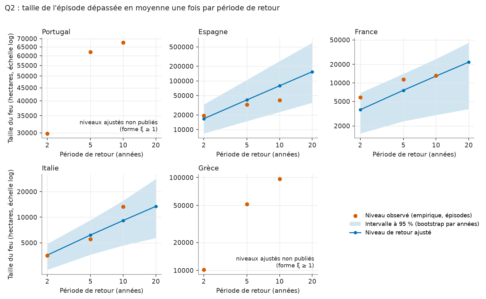
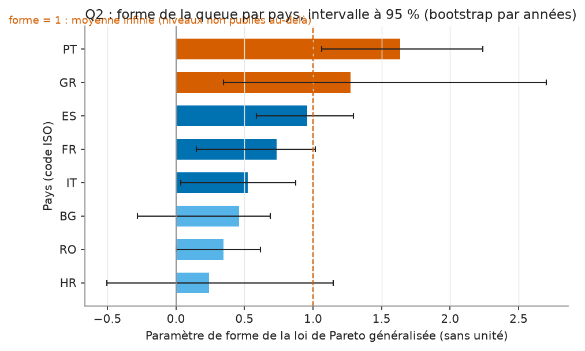

# Carte de modèle : Q2, queue des tailles de feux

Run MLflow : `d5672f4785b64c8f8487e87cf845694c` (expérience `q2_tail_risk`, run
`country_20261109`), 2026-11-09. Les deux tables `tail_risk_country` et
`tail_risk_levels` portent ce `run_id` sur chaque ligne.

## Question

Quelle est la taille d'un feu rare, celui qu'un pays voit en moyenne une fois
tous les 5, 10 ou 20 ans, et avec quelle incertitude ? La réponse sert à
comparer les pays sur leurs plus gros feux, pas sur leur surface brûlée totale,
qui est dominée par la saison la plus sèche de la période.

## Données

- Table `fact_fireevent`, lignes EFFIS : un feu cartographié, sa surface en
  hectares, sa date de départ, son pays.
- Plancher de 30 ha : les feux plus petits ne sont pas modélisés.
- 50 pays ou territoires, 41 578 feux au total. 28 pays ont 10 années complètes
  (2016 à 2025) ; les 22 autres entrent plus tard dans le registre et ont de 1 à 9
  années, l'Ukraine 6 (2020 à 2025).
- Seules les années complètes comptent : l'extraction 2026 s'arrête en juillet,
  avant la plus grande part de la saison du Sud, et la compter comme une année
  entière ferait baisser le taux de feux.

## Méthode

Une loi de probabilité ajustée sur tous les feux décrirait surtout les petits.
On ne modélise donc que la queue, par la méthode des dépassements de seuil
(peaks over threshold), pays par pays :

1. **Seuil** : le quantile 90 % des surfaces du pays (`threshold_quantile=0.9`).
   Pour le Portugal, 835,7 ha. Les feux au-dessus du seuil sont les
   dépassements : 214 sur 10 ans, soit un taux de 21,4 par an.
2. **Loi de Pareto généralisée (GPD)** sur l'excès de chaque dépassement au-dessus
   du seuil, ajustée par maximum de vraisemblance. Deux paramètres : une échelle
   et une **forme** ξ. La forme dit à quelle vitesse la queue s'amincit. ξ = 0 :
   décroissance exponentielle. ξ > 0 : queue lourde, les très gros feux restent
   plausibles. ξ ≥ 1 : l'espérance de l'excès n'existe plus, c'est-à-dire que la
   moyenne des plus gros feux n'est pas bornée par le modèle.
3. **Niveau de retour** x_T : la taille dépassée en moyenne une fois toutes les
   T années, `x_T = u + (sigma / xi) * ((T * taux)^xi - 1)`. C'est ce que montre la
   courbe : on lit « un feu d'au moins x hectares une fois tous les T ans ».
4. **Intervalle** : 500 rééchantillonnages bootstrap des dépassements, refit à
   chaque fois, percentiles 2,5 % et 97,5 % (`n_boot=500`).
5. **Horizon publié** : un niveau n'est publié que jusqu'à deux fois la durée
   observée. Avec 10 ans de données, les niveaux à 2, 5, 10 et 20 ans sont
   publiés, celui à 50 ans est nul par construction.
6. **Seuil d'estimabilité** : moins de 30 dépassements, le pays reste dans la
   table avec des estimations nulles. Ici 20 pays sur 50 sont estimés ; le plus
   petit a 34 dépassements, le plus gros pays non estimé en a 26.

Le niveau empirique est affiché en regard : c'est la taille du k-ième plus gros
feu observé, avec k = années / T. À 10 ans, c'est donc le plus gros feu de la
période.

## Validation

- Tests (`tests/test_models_extremes.py`) : la GPD retrouve des paramètres connus
  sur un échantillon simulé, le niveau de retour et la période de retour sont des
  fonctions inverses, l'horizon suit la durée observée, une année finale partielle
  est exclue, les pays inestimables sont listés et non supprimés.
- Contrôle visuel sur les données réelles : la figure ci-dessous place le niveau
  empirique sur la courbe ajustée, pour quatre pays.



Aucun test d'adéquation de la GPD (Anderson-Darling ou autre) n'est calculé dans
le dépôt. La table de stabilité du seuil (`threshold_stability` dans
`src/models/extremes.py`) existe mais n'est pas matérialisée dans `model_out`.

## Limites

**Dix années de registre ne permettent pas de vérifier un niveau de retour au-delà
de dix à vingt ans, et pour le Portugal et l'Espagne le plus gros feu observé est
sous la borne basse de l'intervalle à 95 % du niveau décennal ajusté.** Un niveau
décennal n'est pas atteint dans dix ans environ une fois sur trois (e^-1, soit
37 %), donc un maximum observé sous le niveau ajusté n'est pas anormal en soi. Mais
sortir de l'intervalle par le bas, comme ici, signale que le modèle et les données ne
s'accordent pas bien, ou que l'intervalle est trop étroit. Les deux lectures sont
possibles avec ce qu'on a calculé.

- **Intervalle trop étroit par construction.** Le bootstrap rééchantillonne les
  dépassements, mais le seuil et le taux annuel sont tenus fixes dans chaque
  réplique. L'incertitude sur le nombre de gros feux par an n'est pas dans la bande.
- **Indépendance supposée.** La GPD suppose des dépassements indépendants. Dans les
  faits, les gros feux se regroupent dans les années sèches et dans les mêmes
  régions. Pas de tendance, pas de covariable.
- **Forme proche ou au-dessus de 1.** Au Portugal ξ = 1,04 : l'extrapolation au-delà
  de la plus grande observation est très sensible à ce paramètre, ce qui explique la
  largeur des intervalles (niveau à 20 ans : 182 365 à 1 583 842 ha).
- **Surface cartographiée.** Le plancher de 30 ha et le périmètre EFFIS fixent ce
  qu'on appelle un feu. Les pays hors de l'Union (Algérie, Ukraine, Turquie et
  d'autres) sont couverts par un registre dont la complétude n'est pas évaluée dans cette carte.
- **30 pays sans estimation.** Pour eux, la table ne dit rien de la queue.

## Résultats

La figure suivante donne la forme ξ et son intervalle pour les 20 pays estimés.
Les barres sombres sont les quatre pays détaillés plus bas.



- La forme médiane est 0,60. Elle va de 0,001 (Croatie) à 1,036 (Portugal). Un seul
  pays dépasse 1 en estimation ponctuelle, cinq ont leur borne haute à 1 ou plus,
  trois ont leur borne basse sous 0 (Croatie, Tunisie, Kosovo). Un intervalle qui
  contient 0 ne distingue pas la queue d'une exponentielle.
- Les pays à queue la plus lourde sont les pays ibériques et la France (Portugal
  1,04, France 0,95, Espagne 0,87). L'Italie (0,60) a la plus grande base de feux
  parmi les quatre (455 dépassements) et l'intervalle le plus étroit.

Quatre pays, niveau décennal (tailles en hectares, intervalles à 95 %) :

| Pays | Feux ≥ 30 ha | Seuil | Dépassements | Forme ξ | Niveau à 10 ans ajusté | Plus gros feu observé |
|---|---|---|---|---|---|---|
| Portugal | 2 140 | 836 | 214 | 1,04 [0,76 ; 1,28] | 286 596 [106 371 ; 653 881] | 67 521 |
| Espagne | 2 846 | 559 | 285 | 0,87 [0,66 ; 1,06] | 131 517 [61 459 ; 283 575] | 40 081 |
| Grèce | 638 | 1 139 | 64 | 0,69 [0,13 ; 1,10] | 45 557 [14 772 ; 130 925] | 96 610 |
| Italie | 4 549 | 297 | 455 | 0,60 [0,47 ; 0,72] | 13 150 [8 039 ; 23 204] | 13 278 |

Lecture :

- **Italie** : niveau ajusté et plus gros feu observé coïncident (13 150 contre
  13 278 ha).
- **Grèce** : le plus gros feu observé (96 610 ha) est plus du double du niveau
  ajusté (45 557 ha) mais reste dans l'intervalle. Seulement 64 dépassements, d'où
  l'intervalle de forme le plus large des 20 pays estimés (0,97 de large).
- **Portugal, Espagne** : niveau ajusté 4,2 et 3,3 fois le plus gros feu observé,
  observé hors de l'intervalle (voir Limites).
- Fréquence des feux de 10 000 ha ou plus selon le modèle : une fois tous les 0,40 an
  au Portugal, 0,54 an en Espagne, 1,29 an en Grèce, 6,33 ans en Italie.

À prendre ainsi : un classement des pays par queue de distribution, avec ses
intervalles, et un ordre de grandeur des niveaux jusqu'à 20 ans. Pas une
prévision de la taille du prochain grand feu.

## Reproduire

Les chiffres ci-dessus sortent de ces commandes, lancées à la racine du dépôt
(tables dans `data/lake/gold/model_out/`, locales et non versionnées).

Tableau des quatre pays (feux, seuil, dépassements, forme, niveau à 10 ans, plus
gros feu, `run_id`) :

```bash
uv run python -c "import pandas as pd; t=pd.read_parquet('data/lake/gold/model_out/tail_risk_country.parquet'); print(t[t.country_key.isin(['PT','ES','GR','IT'])][['country_key','n_fires','threshold_ha','n_exceedances','shape','shape_p2.5','shape_p97.5','rl_10y','rl_10y_p2.5','rl_10y_p97.5','rl_20y_p2.5','rl_20y_p97.5','largest_ha','return_period_10k_ha_years','run_id']].round(2).to_string())"
```

Comptes et statistiques de forme (50 pays, 20 estimés, 41 578 feux, médiane 0,60,
un seul pays au-dessus de 1, cinq avec borne haute à 1 ou plus, trois avec borne
basse sous 0, dépassements minimal et maximal) :

```bash
uv run python -c "import pandas as pd; t=pd.read_parquet('data/lake/gold/model_out/tail_risk_country.parquet'); s=t['shape']; print(len(t), s.notna().sum(), t.n_fires.sum(), round(s.median(),3), (s>1).sum(), (t['shape_p97.5']>=1).sum(), (t['shape_p2.5']<0).sum(), t[s.notna()].n_exceedances.min(), t[s.isna()].n_exceedances.max()); print(t[s.notna()].sort_values('shape')[['country_key','shape','shape_p2.5','shape_p97.5']].round(3).to_string())"
```

Période observée par pays (10 ans, Ukraine 6) :

```bash
uv run python -c "import pandas as pd; t=pd.read_parquet('data/lake/gold/model_out/tail_risk_country.parquet'); print(t.groupby(['first_year','years']).size())"
```

Niveaux de retour de la figure (2, 5, 10, 20 ans, ajustés et empiriques) :

```bash
uv run python -c "import pandas as pd; l=pd.read_parquet('data/lake/gold/model_out/tail_risk_levels.parquet'); print(l[l.country_key.isin(['PT','ES','GR','IT'])].round(0).to_string())"
```

Paramètres et métriques du run :

```bash
uv run python -c "import mlflow; mlflow.set_tracking_uri('sqlite:///mlruns/mlflow.db'); r=mlflow.get_run('d5672f4785b64c8f8487e87cf845694c'); print(r.data.params, r.data.metrics)"
```

Reconstruire la table (nouveau `run_id`) puis les figures :

```bash
uv run dagster asset materialize -m src.orchestration.definitions --select "gold/tail_risk_country"
uv run python scripts/model_figures.py
```

Si la table est reconstruite, le `run_id` en tête de cette page change : la page cite
celui des tables actuellement dans `model_out`.
