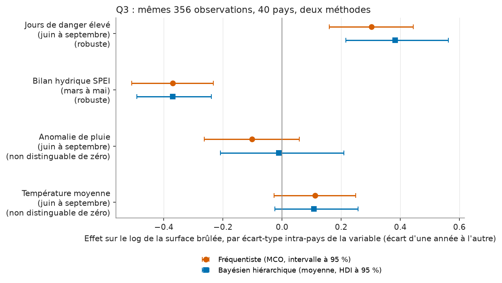
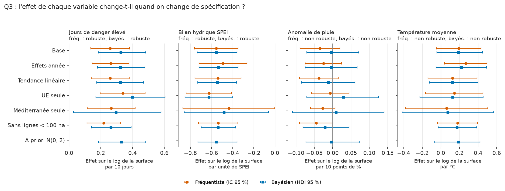
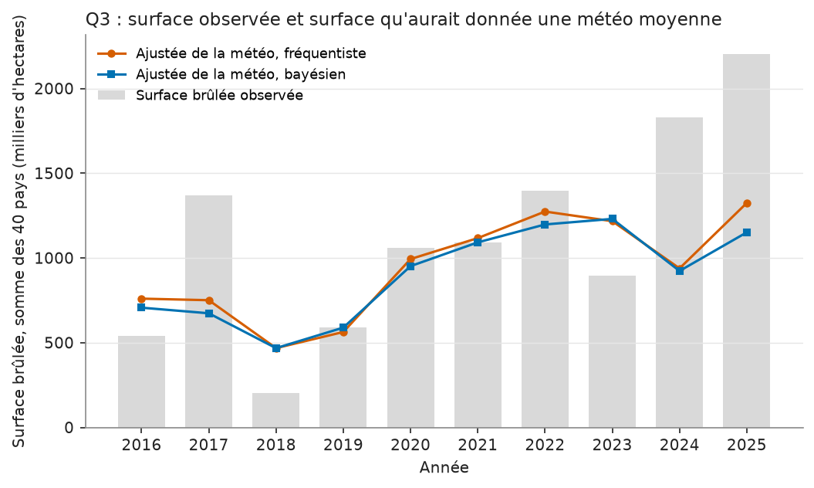

# Carte de modèle : Q3, part de la météo dans la surface brûlée

Trois jeux de tables, tous issus des mêmes lignes :

| Version | Expérience MLflow | `run_id` | Tables |
|---|---|---|---|
| Fréquentiste (MCO, effets fixes pays) | `q3_attribution`, run `ols_fe_20261109` | `31eb92ec7227401cb036848ecf438a60` | `attribution_coefficients`, `attribution_countryyear`, `attribution_summary`, `attribution_exclusions` |
| Bayésienne hiérarchique (PyMC) | `q3_attribution_bayes`, run `hier_20261109` | `e1b00cc4742b4bd58a6ff0825c8f7e7b` | `attribution_bayes_coefficients`, `attribution_bayes_countryyear` |
| Robustesse (7 variantes, les deux modèles) | `q3_attribution_robustness`, run `variants_20261109` | `9a6e2948b6e147c3b1f2fd46d8f6bc23` | `attribution_robustness` |

Les trois runs datent du 2026-11-09 ; chaque ligne des tables porte le `run_id` de
sa version.

!!! abstract "En bref"
    La météo de la saison explique environ 30 % de ce qui fait varier la surface
    brûlée d'un pays d'une année à l'autre, mesuré sur le logarithme de la surface.
    Deux effets tiennent dans toutes les variantes et dans les deux méthodes : dix
    jours de danger élevé en plus vont avec une surface multipliée par 1,3 environ,
    un printemps plus sec d'une unité de SPEI avec un facteur 1,75. La température
    et la pluie ne se distinguent pas de zéro. **Limite principale : dix années par
    pays, une attribution statistique et non causale, et des variables météo liées
    entre elles.**

## Question

Quand un pays brûle beaucoup plus qu'une année ordinaire, quelle part de l'écart
s'explique par la météo de la saison ? Et quelle surface aurait brûlé la même année
avec la météo moyenne du pays ?

Ce qui est estimé est plus étroit que la question : la part de la variance du
**logarithme** de la surface d'un pays, d'une année à l'autre, que quatre variables
météo expliquent. Ce n'est pas une part d'hectares, et un pays qui brûle peu compte
autant qu'un pays qui brûle beaucoup.

La question porte sur les écarts d'un pays à lui-même d'une année sur l'autre.
Elle ne compare pas les pays entre eux : un pays grand et boisé brûle plus qu'un
petit, la méthode neutralise ce niveau propre à chaque pays.

## Données

- Un tableau pays x année, 2016 à 2025. La surface brûlée annuelle par pays vient de la table
  `fact_burntarea_countryyear`, source `EFFIS_RDA`. La variable à expliquer est
  son logarithme, `log(1 + hectares)`.
- Quatre variables de saison, calculées sur la table `fact_fireweather_countrymonth` :
  - `days_high_season` : nombre de jours de danger d'incendie élevé, juin à septembre ;
  - `spei_spring` : bilan hydrique SPEI moyen, mars à mai (négatif = sec) ;
  - `precip_anom_season` : anomalie de pluie moyenne, juin à septembre, en pourcentage
    de la normale mensuelle 1991-2020 (et non en millimètres) ;
  - `temp_season` : température moyenne, juin à septembre.
- Une année n'entre que si les quatre mois de juin à septembre sont présents ; rien
  n'est imputé.
- **Un seul panel pour les deux modèles et pour toutes les tables publiées** : la
  fonction `prepare_panel` (`src/models/attribution.py`) est la seule à écarter des
  lignes. Elle garde les lignes complètes (les quatre variables et la surface
  présentes), puis les pays qui ont au moins 4 années complètes. Résultat : 356
  observations, 40 pays. Avant ce passage, le tableau compte 401 lignes et 49 pays.
- **Pays écartés (9) et pourquoi**, détail dans la table `attribution_exclusions` :

  | Pays | Lignes dans le panel | Lignes sans anomalie de pluie | Raison |
  |---|---|---|---|
  | Égypte (EG), Israël (IL), Jordanie (JO), Libye (LY), Palestine (PS), Syrie (SY) | 1, 10, 4, 9, 7, 10 | toutes | l'anomalie de pluie est vide : la normale mensuelle y est sous le seuil de calcul (zones arides), donc moins de 4 années complètes |
  | Géorgie (GE), Moldavie (MD), Russie (RU) | 1, 2, 1 | aucune | moins de 4 années de données |

  L'écart n'est pas aléatoire : il retire les six pays les plus secs de la
  couverture. Les résultats valent pour les 40 pays conservés et ne disent rien des
  zones arides. Comme la même règle s'applique aux deux modèles, la table
  fréquentiste publiée et le comparateur du modèle bayésien sont identiques (avant
  correction : 360 lignes et 43 pays d'un côté, 356 et 40 de l'autre).
- **Unité de chaque variable.** Chaque variable est centrée sur la moyenne de son pays
  puis divisée par son **écart-type intra-pays** (l'écart-type des valeurs une fois la
  moyenne de chaque pays retirée). Un coefficient se lit « pour un écart d'une année
  à l'autre, typique à l'intérieur d'un pays ». C'est une seule valeur pour tout le
  panel, pas l'écart-type propre à chaque pays : pour les jours de danger, la dispersion
  d'un pays d'une année à l'autre va de zéro (pays du Nord qui n'en comptent jamais) à
  plus de deux fois la valeur commune (Balkans, Ukraine). L'effet par unité physique,
  donné à côté, ne dépend pas de ce choix. L'écart-type du panel entier, utilisé
  avant, mêlait les écarts entre pays aux écarts dans le temps et gonflait les
  multiplicateurs de la température et des jours de danger (voir Limites).
  Chaque effet est aussi publié **par unité physique** : par 10 jours de danger, par
  unité de SPEI, par 10 points de pourcentage d'anomalie de pluie, par °C.

  | Variable | Écart-type intra-pays | Écart-type du panel | Rapport |
  |---|---|---|---|
  | Jours de danger élevé | 11,66 jours | 44,59 jours | 0,26 |
  | SPEI de printemps | 0,67 | 0,71 | 0,94 |
  | Anomalie de pluie | 29,5 points | 31,2 points | 0,95 |
  | Température | 0,58 °C | 4,52 °C | 0,13 |

## Méthode

**Fréquentiste.** Une régression linéaire (moindres carrés) du log de la surface sur
les quatre variables et une constante par pays (effets fixes), erreurs standard
groupées par pays, intervalles de confiance à 95 %. Un coefficient b se lit : un
écart-type intra-pays de plus de la variable multiplie la surface brûlée du même pays
par exp(b). Pour chaque pays et chaque année, la **composante météo** est la somme des
coefficients multipliés par l'écart de chaque variable à la moyenne du pays. La
**surface ajustée** est la surface que l'année aurait donnée avec cette composante à
zéro, c'est-à-dire avec la météo moyenne du pays : `expm1(log_surface - composante_meteo)`.

**Bayésienne hiérarchique.** Même tableau, même standardisation, mais chaque pays
a sa propre pente pour chaque variable, tirée d'une loi commune :

```
log_surface[pays, an] = alpha[pays] + somme_k( beta[pays, k] * z[pays, an, k] ) + bruit
beta[pays, k] = mu_beta[k] + tau[k] * b_raw[pays, k]
```

`mu_beta[k]` est la pente moyenne sur l'ensemble des pays, celle que la version
fréquentiste estime d'un bloc. `tau[k]` mesure combien les pays s'écartent de cette
pente moyenne. Conséquence pratique : un pays qui n'a que dix observations pour quatre
pentes emprunte de la force aux autres (on parle de mise en commun partielle) au lieu
de produire une pente instable. Le résultat n'est pas un nombre mais une distribution
des valeurs plausibles de chaque coefficient, compte tenu des données et des a priori.
On en publie la moyenne et un **intervalle HDI à 95 %**, le plus étroit des intervalles
qui contiennent 95 % de la distribution, de même niveau que l'intervalle de confiance
fréquentiste.

A priori, tous faiblement informatifs : `mu_beta ~ N(0, 1)`, `tau ~ HalfNormal(0,5)`,
`mu_alpha ~ N(8, 3)`, `sigma_alpha ~ HalfNormal(2)`, `sigma ~ HalfNormal(1,5)`. Les
raisons de chaque choix sont dans le docstring de `src/models/attribution_bayes.py`.
Les pentes sont non centrées (reparamétrisation qui évite les divergences du
sampler quand il y a peu de données par pays), les constantes sont centrées.

Échantillonnage : sampler NUTS de PyMC, 4 chaînes de 1000 tirages après 1000 de
chauffe, `target_accept = 0,99`, backend Numba sans compilateur C
([ADR 0010](../adr/0010-pymc-windows-native.md)).

**Robustesse, et règle de la colonne `robust`.** La règle est écrite dans le docstring
de `src/models/attribution.py` et a été commitée avant l'exécution des variantes :
une variable est dite **robuste** si son intervalle à 95 % de la spécification de
base exclut zéro **et** si son signe est le même dans toutes les variantes. Une variable
non robuste est présentée comme non distinguable de zéro. Variantes (table
`attribution_robustness`, comparées par effet par unité physique) : base, effets année,
tendance linéaire, UE seule (25 pays, 215 observations), pays méditerranéens seuls (8
pays, 79 observations : PT ES FR IT GR HR CY SI, Malte est absente du panel),
sans les lignes sous 100 ha (36 pays, 309 observations, le plancher de cartographie
d'EFFIS rend ces lignes peu fiables), et, côté bayésien seulement, a priori `N(0, 2)` sur
les pentes.

## Validation

- **Tests** (`tests/test_models_attribution.py`, `tests/test_models_attribution_bayes.py`) :
  l'écart-type intra-pays retrouve la valeur attendue sur un panel simulé où les pays
  ont des niveaux de 0, 100 et 1000 ; la pente par unité physique est retrouvée quand
  les pays diffèrent fortement ; les deux modèles reçoivent exactement les mêmes lignes
  (mêmes clés pays et année, même fonction de préparation) ; la règle `robust` est
  éprouvée sur des cas limites (intervalle de base qui contient zéro, signe qui change,
  variante absente) ; les schémas des tables sont vérifiés ; une pente connue est
  retrouvée par le modèle bayésien sur un jeu simulé.
- **Diagnostics du sampler**, règle d'acceptation de l'ADR 0010 reprise par l'asset
  check `sampler_diagnostics` (passé) : R-hat maximal 1,0052 (limite 1,01), 0 divergence,
  ESS bulk minimal 974, ESS tail minimal 1168. Pour les sept variantes bayésiennes :
  R-hat maximal 1,0086, 0 divergence. Le R-hat compare la variance entre
  chaînes à la variance dans chaque chaîne ; proche de 1, les chaînes racontent la
  même histoire. L'ESS est le nombre de tirages indépendants équivalents.
- **Comparaison des deux méthodes sur les mêmes lignes** : première figure.



- **Robustesse aux spécifications** : deuxième figure, effet par unité physique sous
  chaque variante, les deux modèles.



- **Ajustement dans l'échantillon** : troisième figure, surface observée contre
  surface ajustée de la météo, par année.



- **Validation hors échantillon, version fréquentiste.** Le run MLflow `72c0037d...`
  enregistre un contrôle en laissant une année de côté (`leave_one_year_out_r2`) :
  on ajuste sur neuf années, on prédit la dixième, et on compare à la prédiction naïve
  « la moyenne du pays ». Erreur quadratique moyenne (RMSE, en unités de log de
  surface), pondérée par le nombre d'observations : 1,127 pour le modèle contre 1,326
  pour la moyenne du pays. Le gain hors échantillon, `r2_oos_vs_country_mean` de la table
  `attribution_summary` (un moins le rapport des erreurs quadratiques moyennes), est de
  0,277. Le modèle fait mieux dans 9 des 10 années laissées de côté, moins bien en 2019
  (0,960 contre 0,932). Ce contrôle n'existe pas pour la version bayésienne.

## Limites

**Cette attribution est statistique, pas causale : elle décrit comment la surface
brûlée d'un pays varie avec la météo de sa saison sur dix ans, avec 356 observations
pour 40 pays, et rien dans le modèle ne sépare la météo de ce qui l'accompagne.**
Concrètement :

- **Variance non expliquée.** Les quatre variables expliquent environ 31 % de la
  variabilité d'un pays d'une année sur l'autre (R² intra-pays 0,309, mesuré dans
  l'échantillon ; 0,28 de l'erreur quadratique de la moyenne du pays est retiré hors
  échantillon). Les 70 % restants peuvent venir des départs de feu, de l'activité
  humaine, de la gestion ou d'autres facteurs ; le modèle ne les mesure pas. Seul ce
  R² intra-pays a un sens pour l'attribution. Le R² poolé avec les effets pays (environ
  0,87) mesure surtout le niveau propre à chaque pays : il n'est plus calculé ni publié, et
  l'ancienne colonne `r2_within_total` est supprimée (elle valait toujours
  `r2_within_weather`).
- **Écart-type intra-pays, ordre de grandeur des effets.** Avec l'écart-type du panel entier,
  les multiplicateurs publiés étaient x3,06 (jours de danger) et x2,76 (température).
  Un écart-type du panel de température (4,5 °C) n'a aucun sens pour un pays dont la
  saison varie de 0,58 °C d'une année à l'autre. Par écart-type intra-pays, les
  multiplicateurs sont x1,35 (jours de danger) et x1,12 (température) en fréquentiste.
- **Variables liées entre elles.** Le nombre de jours de danger élevé est lui-même une
  fonction de la température, de la pluie et d'autres champs. Le coefficient de la
  température est donc lu « à nombre de jours de danger donné », il n'est pas
  l'effet total de la température.
- **Température et pluie non distinguables de zéro.** L'intervalle de base contient
  zéro dans les deux méthodes. La température change de signification selon la
  spécification : son intervalle exclut zéro avec les effets année (fréquentiste,
  0,27 par °C), pas sans, et l'effet tombe à 0,13 à 0,14 par °C sur l'UE seule et à 0,06 à 0,08 sur les pays
  méditerranéens. Pour la pluie, le signe change entre variantes côté bayésien. Elles
  sont présentées comme non distinguables de zéro, pas comme sans effet. Ce que le modèle
  établit, ce sont les jours de danger et le déficit hydrique de printemps.
- **Pentes différentes selon les pays.** La pente moyenne cache des écarts : l'écart-type
  entre pays de la pente de la pluie est 0,29 (intervalle 0,05 à 0,54), seul des quatre à
  exclure nettement zéro. Un pays donné peut s'écarter de la pente moyenne.
- **Pays écartés.** Voir Données : six pays arides sont absents faute d'anomalie de
  pluie, la couverture ne vaut pas pour les zones arides. Le panel n'est pas équilibré :
  25 pays en 2016, 40 en 2025 (la source EFFIS passe elle-même de 28 à 47 pays), et le
  plancher de cartographie d'EFFIS change en 2020 ; la variante
  sans les lignes sous 100 ha laisse les signes inchangés.
- **Poids de l'Ukraine et de la Turquie.** L'Ukraine porte 21,6 % des hectares du
  panel et la Turquie 8,5 %, et les feux ukrainiens depuis 2022 ne relèvent pas que de la
  météo. En hectares, elles dominent toute somme ; dans la régression, chaque pays pèse
  par ses années, mais l'Ukraine a aussi l'une des plus fortes dispersions de jours de danger, donc
  un fort levier sur cette pente. La variante « UE seule » retire les deux (25 pays, 215
  observations) : les deux effets robustes y sont un peu plus forts, pas plus faibles
  (jours de danger 0,35 contre 0,30, SPEI -0,42 contre -0,37). La somme des surfaces
  ajustées sur tous les pays, elle, reste dominée par ces deux pays et par la
  composition du panel : elle se lit par pays.
- **Quatre coefficients, treize ajustements, pas de correction de multiplicité.** La règle
  `robust` (intervalle de base hors de zéro et même signe partout) est plus stricte
  qu'un seuil à 5 % par test, mais ce n'est pas une correction formelle.
- **Surface ajustée, mise en garde d'usage.** Elle se calcule sur l'échelle logarithmique
  puis revient en hectares. La somme de plusieurs pays d'une surface ajustée n'est
  pas une espérance de la surface totale ; c'est un repère visuel pour comparer
  une année à une météo moyenne.
- **Une seule source de surface.** Seul le registre EFFIS `EFFIS_RDA` alimente le
  panel.

## Résultats

Même échantillon de 356 observations et 40 pays pour les deux méthodes. Intervalles à
95 % des deux côtés (intervalle de confiance, HDI). Le coefficient se lit sur le log de
la surface, par écart-type intra-pays ; le multiplicateur est exp(coefficient).

| Variable | Fréquentiste | Bayésien (moyenne) | Multiplicateur par écart-type intra-pays (fréq. / bayés.) | P(coef > 0) bayésien | `robust` |
|---|---|---|---|---|---|
| Jours de danger élevé (juin à septembre) | 0,302 [0,160 ; 0,444] | 0,382 [0,216 ; 0,563] | x 1,35 / x 1,47 | 1,000 | oui |
| Bilan hydrique SPEI (mars à mai) | -0,370 [-0,508 ; -0,232] | -0,370 [-0,491 ; -0,240] | x 0,69 / x 0,69 | 0,000 | oui |
| Anomalie de pluie (juin à septembre) | -0,102 [-0,263 ; 0,058] | -0,011 [-0,209 ; 0,209] | x 0,90 / x 0,99 | 0,444 | non |
| Température moyenne (juin à septembre) | 0,111 [-0,027 ; 0,250] | 0,108 [-0,025 ; 0,257] | x 1,12 / x 1,11 | 0,932 | non |

Effet par unité physique (coefficient sur le log de la surface, intervalle à 95 %,
multiplicateur entre parenthèses ; fréquentiste puis bayésien) :

| Variable | Unité | Fréquentiste | Bayésien |
|---|---|---|---|
| Jours de danger élevé | par 10 jours | 0,259 [0,137 ; 0,381] (x 1,30) | 0,327 [0,185 ; 0,483] (x 1,39) |
| SPEI de printemps | par unité de SPEI | -0,555 [-0,762 ; -0,348] (x 0,57) | -0,554 [-0,736 ; -0,359] (x 0,57) |
| Anomalie de pluie | par 10 points de % | -0,035 [-0,089 ; 0,020] (x 0,97) | -0,004 [-0,071 ; 0,071] (x 1,00) |
| Température | par °C | 0,193 [-0,048 ; 0,433] (x 1,21) | 0,188 [-0,043 ; 0,446] (x 1,21) |

Lecture :

- **Deux effets robustes, deux non distinguables de zéro.** Les jours de danger
  (signe positif) et le bilan hydrique de printemps (signe négatif) ont un intervalle de
  base qui exclut zéro et le même signe dans les six variantes fréquentistes et les sept
  variantes bayésiennes. Dix jours de danger de plus dans la saison vont avec une
  surface brûlée multipliée par 1,3 environ ; une unité de SPEI de moins (plus sec) avec
  un facteur 1,75 (1 / 0,57). La température et la pluie ne passent pas la règle : leur
  intervalle de base contient zéro. Pour la pluie, le signe change côté bayésien selon
  les variantes.
- **Accord entre méthodes.** Même signe pour les quatre variables en base. Le bayésien
  donne un effet des jours de danger plus grand de 0,08 (0,38 contre 0,30 par écart-type
  intra-pays). L'écart vient de la pluie : son effet diffère selon les pays (voir
  ci-dessous), ce que le modèle hiérarchique autorise et que la régression à pente
  commune interdit. Pluie et jours de danger sont liés (corrélation intra-pays -0,47),
  si bien qu'une pente de pluie libre par pays rend aux jours de danger ce que la pente
  commune leur prenait : la même régression avec une pente de pluie par pays donne 0,49
  pour les jours de danger, le bayésien, qui ne libère les pentes qu'en partie, 0,38.
  Les intervalles des deux méthodes se recouvrent largement.
- **Hétérogénéité entre pays** (écart-type des pentes, bayésien, par écart-type
  intra-pays) : jours de danger 0,08, SPEI 0,11, pluie 0,29, température 0,14.
  Seule la pluie a un intervalle qui exclut nettement zéro.
- **Part de variance.** R² intra-pays de la météo : 0,309 fréquentiste ; 0,347
  bayésien global (pentes propres à chaque pays, mesuré dans l'échantillon). Par
  pays, le R² bayésien a pour médiane 0,30 et va de 0,07 à 0,56.

Observé et ajusté, somme des 40 pays, en milliers d'hectares (bayésien / fréquentiste) :

| Année | Observé | Ajusté bayésien | Ajusté fréquentiste |
|---|---|---|---|
| 2017 | 1 369 | 674 | 751 |
| 2018 | 203 | 468 | 468 |
| 2023 | 895 | 1 231 | 1 217 |
| 2024 | 1 828 | 923 | 939 |
| 2025 | 2 206 | 1 151 | 1 325 |

Les années 2017, 2024 et 2025 sont celles où la surface observée dépasse le plus la
surface ajustée de la météo : en 2025, 2 206 contre 1 151 (bayésien), soit 48 % de moins
avec une météo moyenne. La série ajustée ne devient pas plate : elle va de 468 à 1 231
en bayésien, la météo n'explique pas tout.

À prendre ainsi : les jours de danger et le déficit hydrique de printemps vont avec
des surfaces brûlées plus grandes, avec la même intensité dans les deux
méthodes et dans toutes les variantes. La température et la pluie ne se distinguent
pas de zéro dans ces données.

## Reproduire

Depuis la racine du dépôt (tables locales dans `data/lake/gold/model_out/`).

Tableau des coefficients, comparaison fréquentiste et bayésienne, `P(>0)`, multiplicateurs,
effets par unité, `robust`, R-hat :

```bash
uv run python -c "import pandas as pd; b=pd.read_parquet('data/lake/gold/model_out/attribution_bayes_coefficients.parquet'); print(b[b.level=='population'][['metric','freq_coef','freq_ci_low','freq_ci_high','mean','hdi_low','hdi_high','area_multiplier','mean_per_unit','hdi_low_per_unit','hdi_high_per_unit','prob_positive','robust','r_hat','ess_bulk','run_id']].round(3).to_string()); print(b[b.level=='between_country_sd'][['metric','mean','hdi_low','hdi_high']].round(3).to_string()); print(b.r_hat.max())"
```

Version fréquentiste (même panel, 356 lignes, 40 pays), effets par unité et R² :

```bash
uv run python -c "import pandas as pd; M='data/lake/gold/model_out/'; print(pd.read_parquet(M+'attribution_coefficients.parquet').drop(columns=['unit_label','metric_name']).round(4).to_string()); print(pd.read_parquet(M+'attribution_summary.parquet').T)"
```

Pays écartés et raison :

```bash
uv run python -c "import pandas as pd; print(pd.read_parquet('data/lake/gold/model_out/attribution_exclusions.parquet').to_string())"
```

Table de robustesse (effet par unité, intervalle, `robust`, diagnostics du sampler) :

```bash
uv run python -c "import pandas as pd; r=pd.read_parquet('data/lake/gold/model_out/attribution_robustness.parquet'); print(r[['model','variant','metric','coef_per_unit','ci_low_per_unit','ci_high_per_unit','n_obs','n_countries','robust','rhat_max','divergences']].round(3).to_string())"
```

Contrôle hors échantillon (RMSE du modèle et de la moyenne du pays, par année laissée
de côté, puis pondérées) :

```bash
uv run python -c "import json, pandas as pd, numpy as np; j=json.load(open('mlruns/artifacts/31eb92ec7227401cb036848ecf438a60/artifacts/leave_one_year_out.json')); d=pd.DataFrame(j['data'],columns=j['columns']); print(d.round(3).to_string()); w=d.n; print(np.sqrt((d.rmse_model**2*w).sum()/w.sum()).round(3), np.sqrt((d.rmse_country_mean**2*w).sum()/w.sum()).round(3), (d.rmse_model<d.rmse_country_mean).sum())"
```

Écart-type intra-pays et écart-type du panel de chaque variable (table fréquentiste) :

```bash
uv run python -c "import pandas as pd; print(pd.read_parquet('data/lake/gold/model_out/attribution_coefficients.parquet')[['metric','sd_within','sd_pooled','unit_label']].round(3).to_string())"
```

Totaux par année de la dernière figure (observé, ajusté bayésien, ajusté fréquentiste, 40 pays) :

```bash
uv run python -c "import pandas as pd; M='data/lake/gold/model_out/'; b=pd.read_parquet(M+'attribution_bayes_countryyear.parquet'); f=pd.read_parquet(M+'attribution_countryyear.parquet'); print(pd.DataFrame({'obs':b.groupby('year').burnt_area_ha.sum()/1e3,'adj_bayes':b.groupby('year').adjusted_area_ha.sum()/1e3,'adj_freq':f.groupby('year').adjusted_area_ha.sum()/1e3}).round(0)); print(len(b), b.country_key.nunique(), len(f)); g=b.groupby('country_key')['r2_weather'].first(); print(g.median().round(3), g.min().round(3), g.max().round(3))"
```

Diagnostics du sampler, paramètres et durée du run bayésien :

```bash
uv run python -c "import mlflow; mlflow.set_tracking_uri('sqlite:///mlruns/mlflow.db'); r=mlflow.get_run('e1b00cc4742b4bd58a6ff0825c8f7e7b'); print(r.data.params); print(r.data.metrics)"
```

Reconstruire les tables (nouveaux `run_id`, une dizaine de minutes pour les sept
variantes bayésiennes), puis les figures :

```bash
uv run dagster asset materialize -m src.orchestration.definitions --select "gold/attribution_robustness,gold/attribution_countryyear,gold/attribution_bayes"
uv run python scripts/model_figures.py
```

Si les tables sont reconstruites, les `run_id` du haut de cette page changent.
