# Le rapport en images

Le rapport Power BI se lit dans Power BI Desktop (`powerbi/WildfireEU.pbip`),
sous Windows. Cette page en donne les treize pages pour qui ne l'a pas :
dix pages descriptives, où chaque chiffre est une agrégation d'une source
publique citée sur la page, puis trois pages de modèles, séparées et nommées
comme telles. Le rapport est en anglais.

Les captures sont prises sur les données de l'extraction de juillet 2026.

## Pages descriptives

### Cover

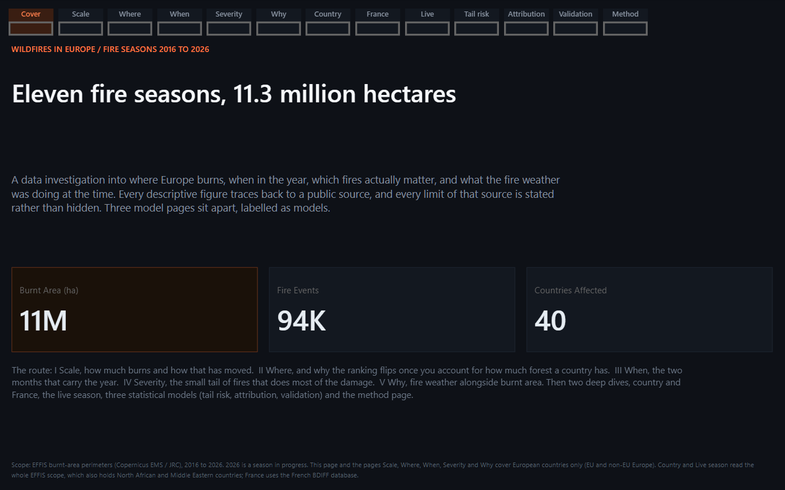

### Scale : combien l'Europe brûle

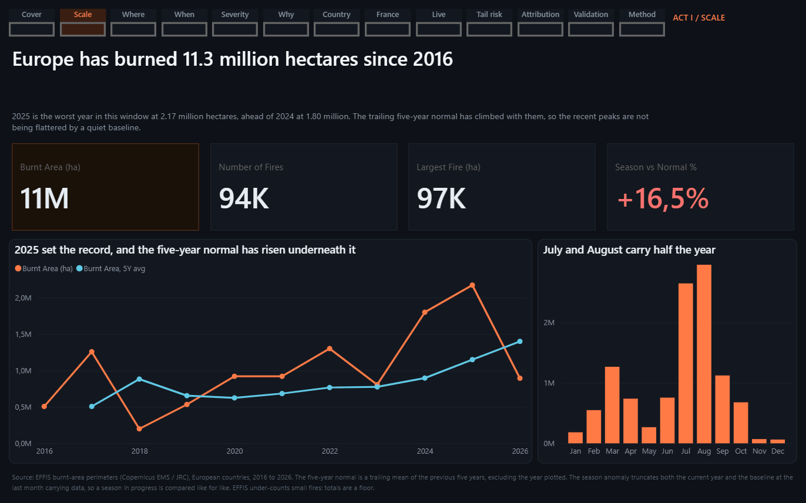

### Where : où

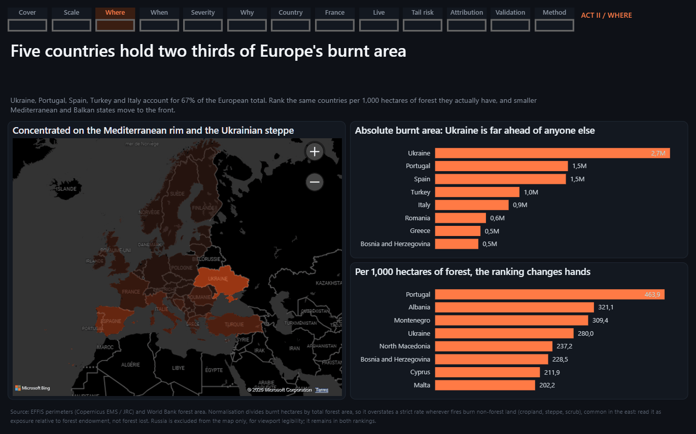

### When : quand dans l'année

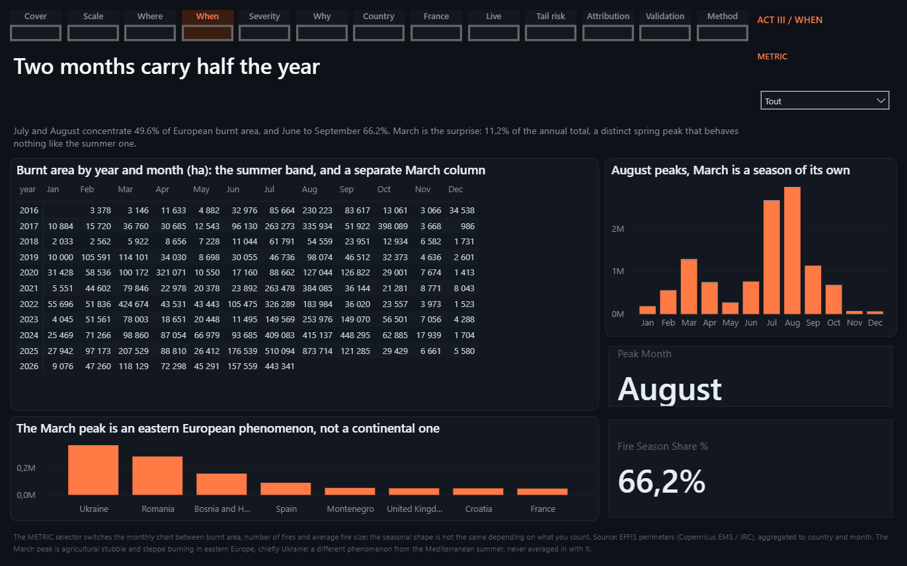

### Severity : quels feux comptent

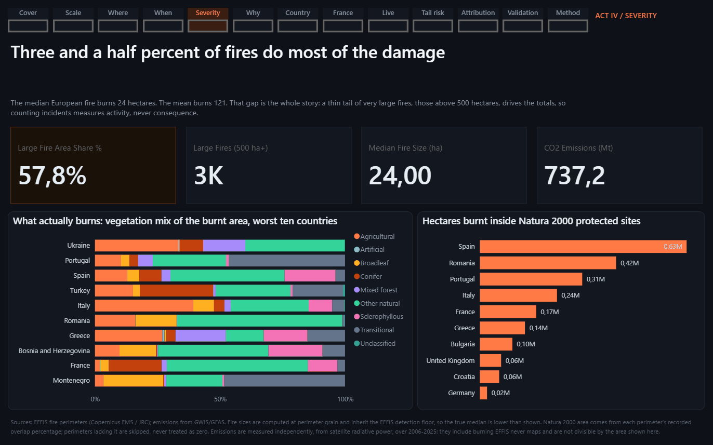

### Why : la météo au même moment

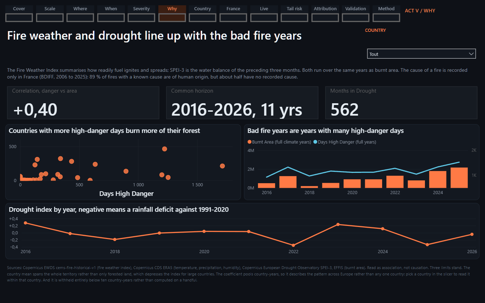

### Country : un pays à la fois

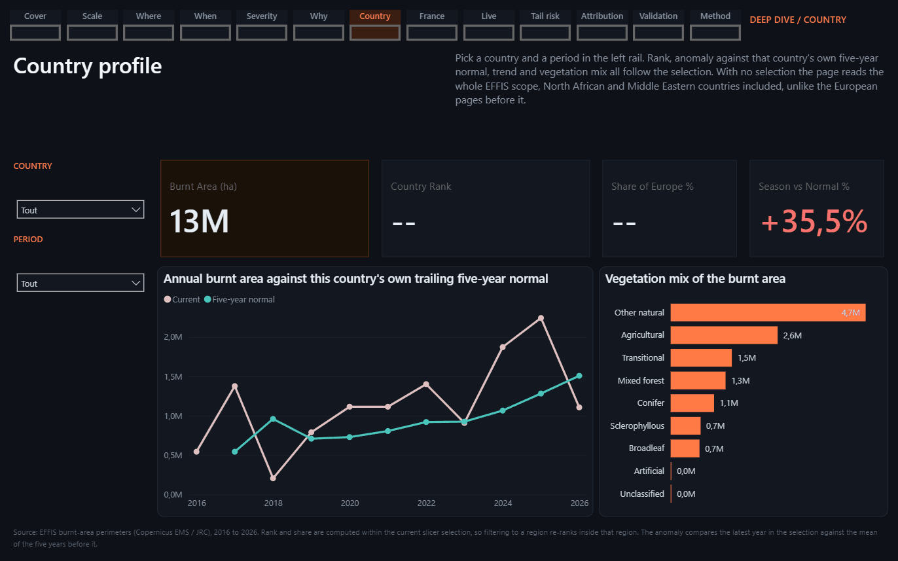

### France : à la commune et à la cause

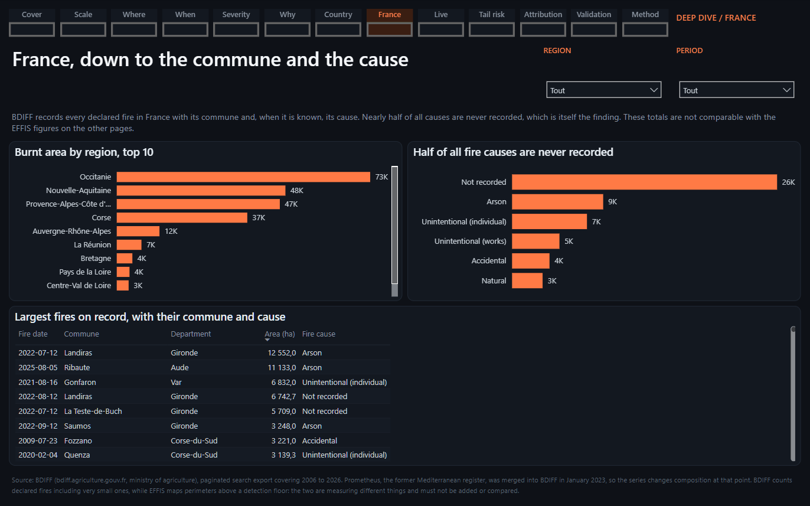

### Live season : la saison en cours

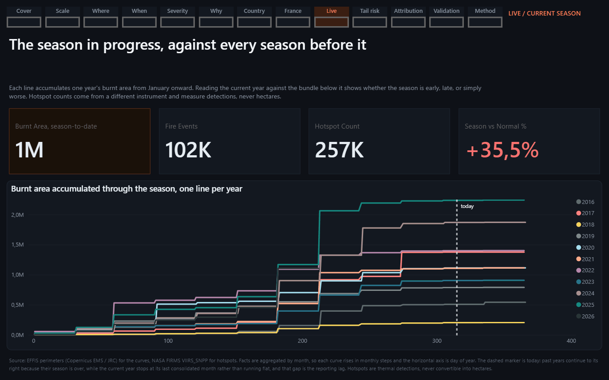

## Pages de modèles

Chacune a sa [carte de modèle](models/index.md), qui donne les limites avant
les résultats.

### Tail risk : la taille des feux rares

Carte : [Q2, queue des tailles de feux](models/q2-tail-risk.md).

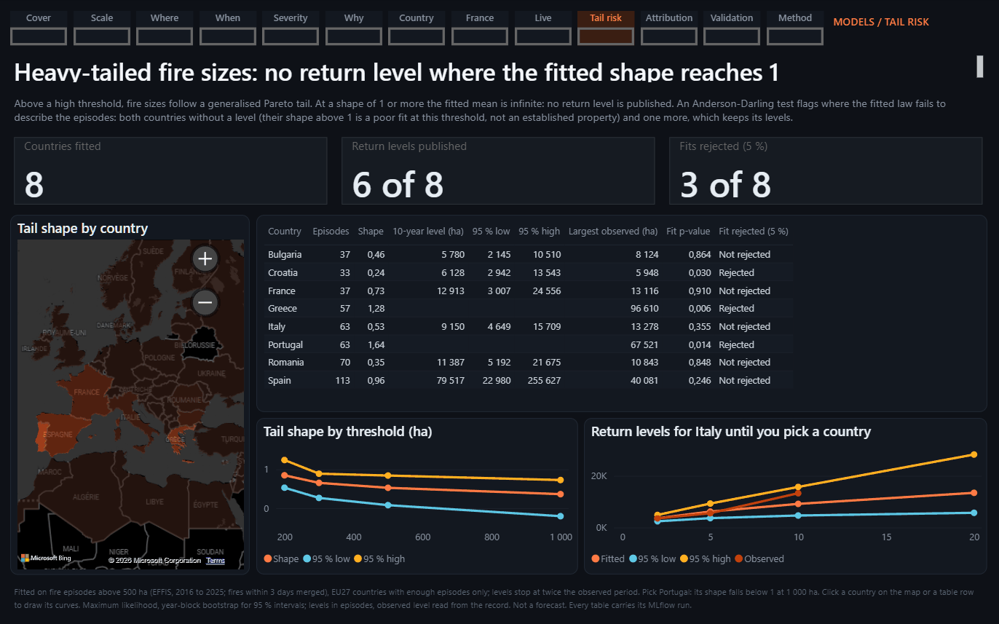

### Attribution : la part de la météo

Carte : [Q3, attribution à la météo](models/q3-attribution.md).

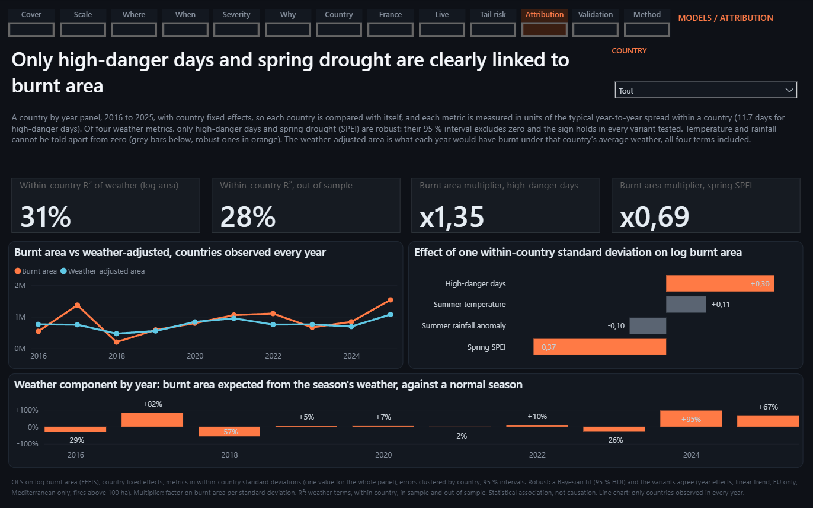

### Validation : le modèle d'occurrence face à son critère

Carte : [Q1, spike d'occurrence](models/q1-ignition-spike.md).

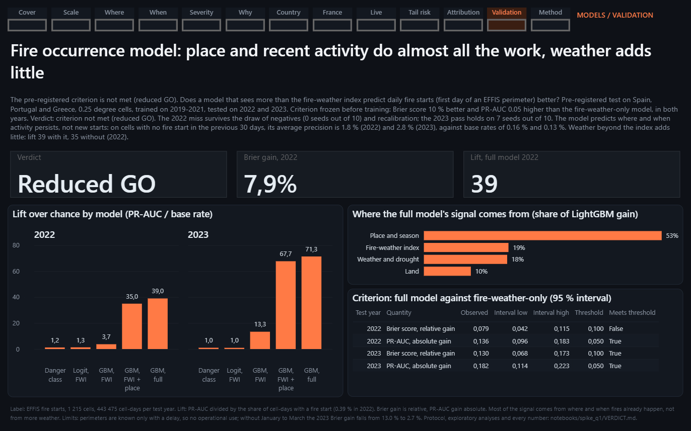

## Méthode et sources

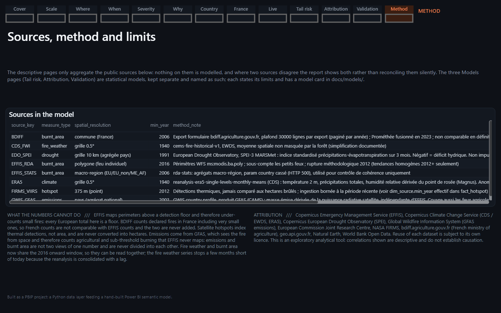
